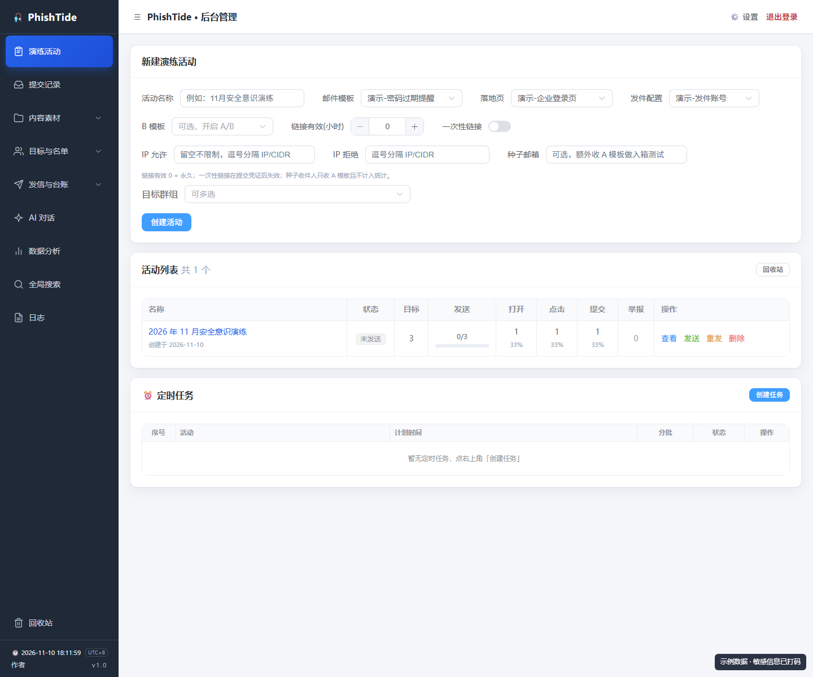
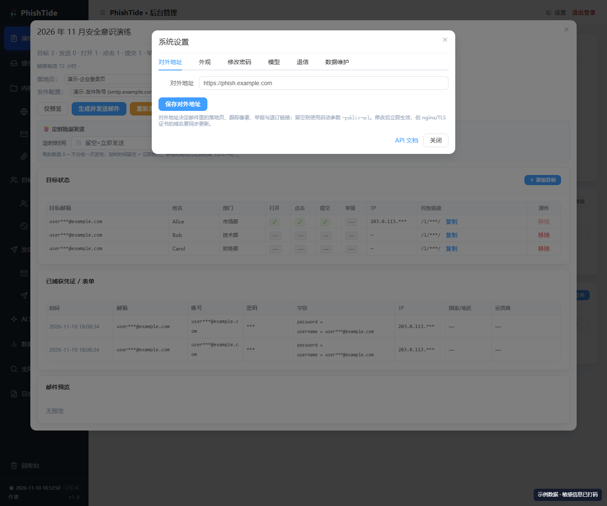
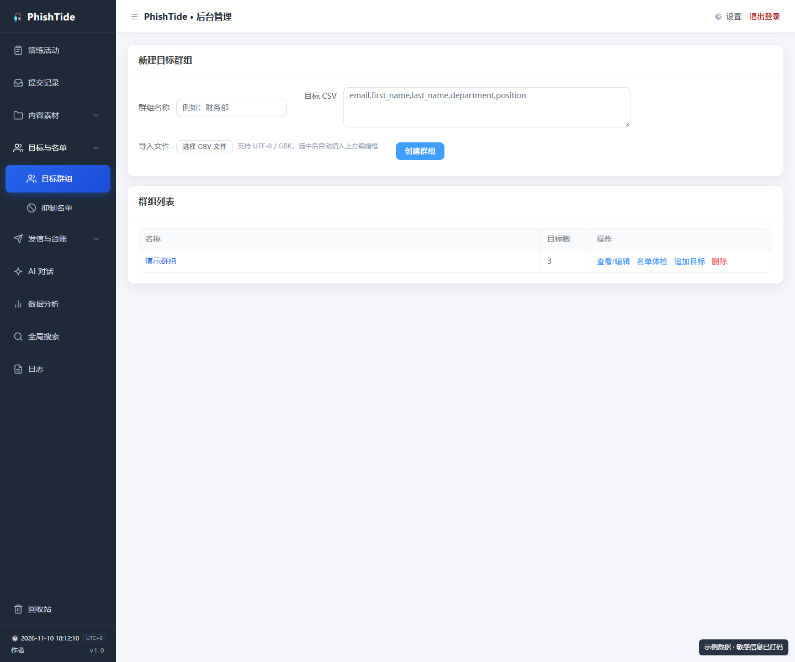
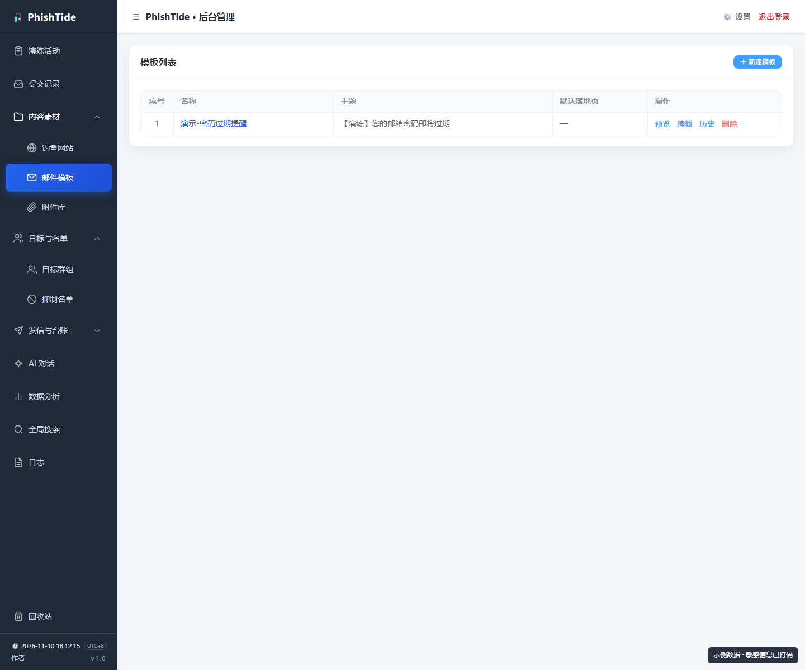
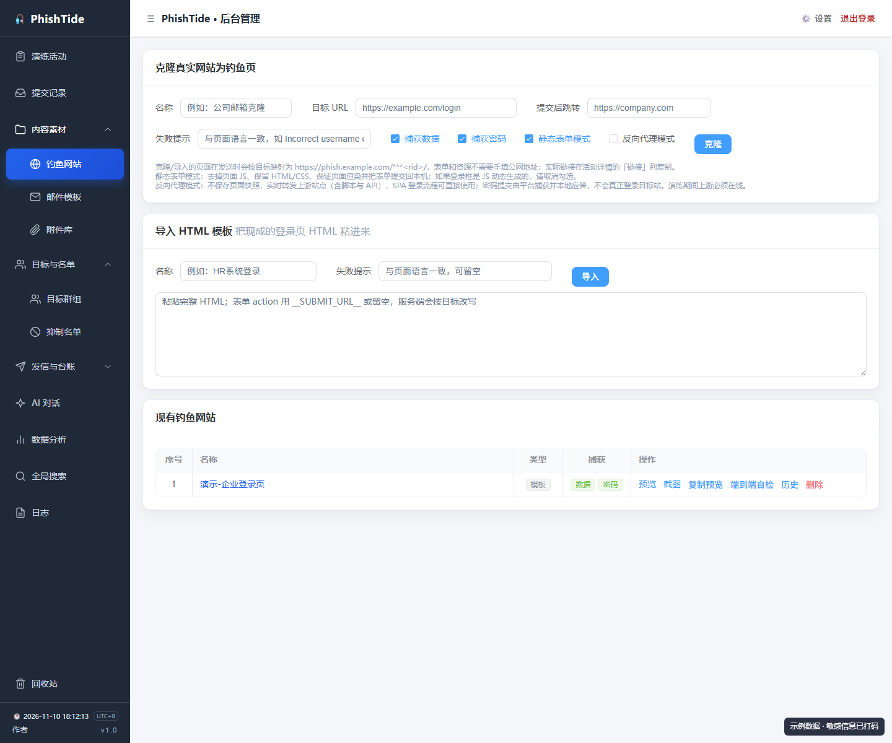
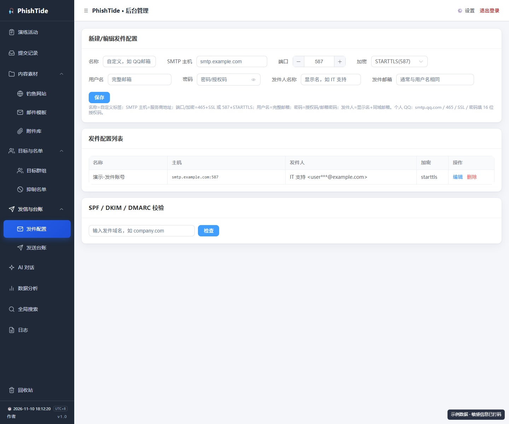
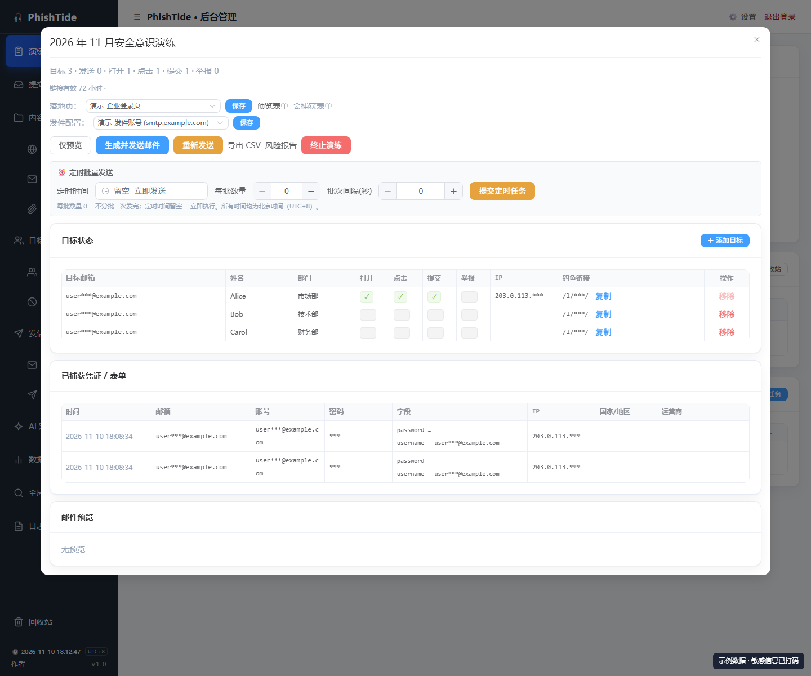
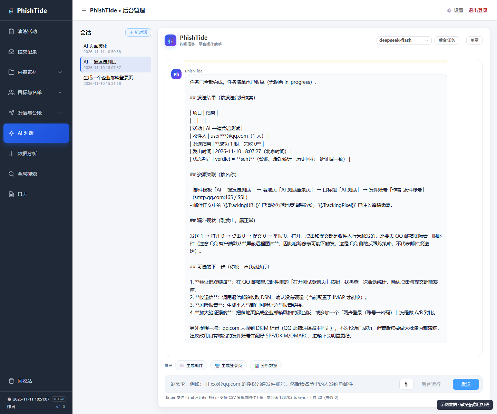
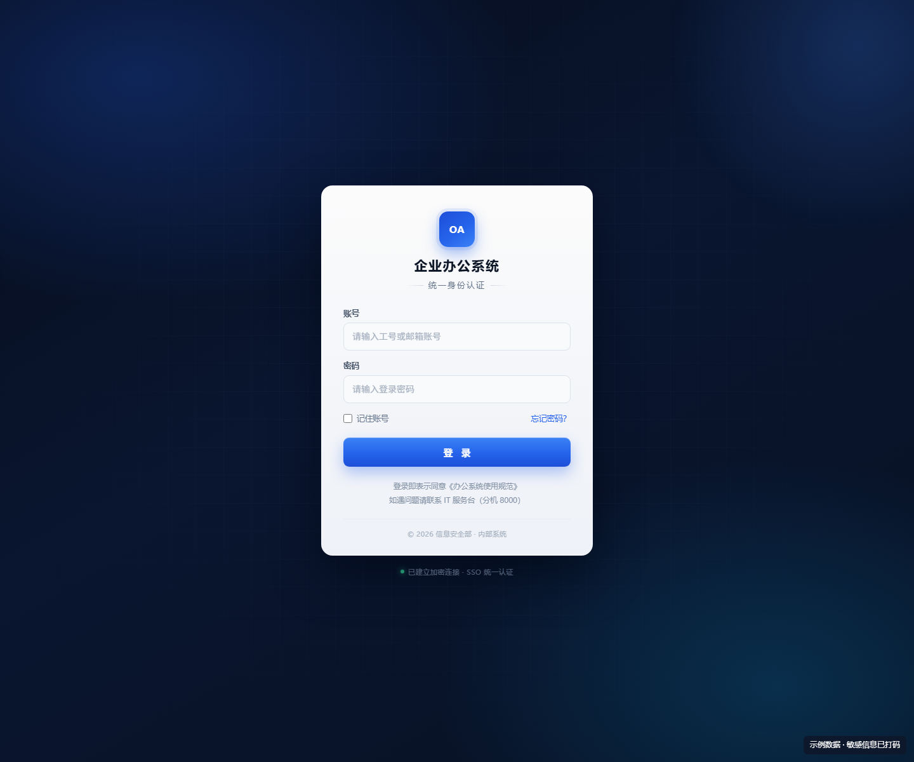

<p align="center">
  <br>
  <strong>Questions? Scan to contact the author</strong>
</p>

# PhishTide One-Click Deployment (Ubuntu / Debian for beginners)

This guide is for someone who has never used a Linux server. Copy the commands one step at a time. You do not need Go, MySQL, nginx, or Docker on the server.

> Use this software only for **authorized phishing simulations and internal security awareness training**.

---

## 0. What you get

On one Ubuntu / Debian server:

- the PhishTide static binary (no Go/glibc dependency)
- a systemd service that starts on boot (`phishsim`)
- SQLite by default (no database server to install)
- a generated admin password
- an admin URL: `https://SERVER_IP:8443/__admin`
- automatic firewall opening when `ufw` or `firewalld` is active

---

## 1. Requirements

| Item | Notes |
| --- | --- |
| Ubuntu 20.04+ / Debian 11+ | 1 vCPU / 1 GB RAM is enough |
| root access | password or SSH key |
| one open TCP port | default **8443** (open it in the cloud security group) |
| (optional) a domain | only needed for a trusted HTTPS certificate |

---

## 2. Connect to the server

Windows PowerShell:

```powershell
ssh root@YOUR_SERVER_IP
```

macOS/Linux terminal:

```bash
ssh root@YOUR_SERVER_IP
```

Type `yes` for the host-key prompt, then the root password (it is not displayed while typing).

Common errors:

| Error | Fix |
| --- | --- |
| `Connection refused` | server off, or SSH not on port 22 |
| `Connection timed out` | security group does not allow 22/tcp, or wrong IP |
| `Permission denied` | wrong password, or root login disabled — use the cloud console/VNC |
| `REMOTE HOST IDENTIFICATION HAS CHANGED` | reinstall; run `ssh-keygen -R YOUR_IP` |

---

## 3. Open port 8443

In your cloud console (Aliyun/Tencent/Huawei/AWS):

- Add an inbound rule: `TCP`, port `8443`, source `0.0.0.0/0`.

On the server, the installer runs `ufw allow 8443/tcp` when ufw is active. Check with:

```bash
ufw status
```

If 8443 is taken, install with `--port 9443` and open that port instead.

---

## 4. Download the one-click bundle

From the repository's **Releases** page (public, no sign-in required):

```
https://github.com/shangdi-w/PhishTide/releases
```

Download:

| Server | File |
| --- | --- |
| x86_64 (most servers) | `phishsim-oneclick-linux-amd64.tar.gz` |
| ARM64 (Graviton/Ampere) | `phishsim-oneclick-linux-arm64.tar.gz` |

Directly on the server:

```bash
cd /root
curl -L -o phishsim-oneclick-linux-amd64.tar.gz \
  https://github.com/shangdi-w/PhishTide/releases/latest/download/phishsim-oneclick-linux-amd64.tar.gz
```

Or upload it from your PC:

```powershell
scp C:\Users\YOU\Downloads\phishsim-oneclick-linux-amd64.tar.gz root@YOUR_SERVER_IP:/root/
```

Or use WinSCP and drag the file to `/root/`.

---

## 5. Extract and install

In the SSH window:

```bash
cd /root
tar xzf phishsim-oneclick-linux-amd64.tar.gz
cd phishsim-oneclick-linux-amd64
sudo ./install.sh
```

The installer prints:

```
============================================================
 PhishTide installed
------------------------------------------------------------
 Admin URL : https://YOUR_SERVER_IP:8443/__admin
 Username  : admin
 Password  : <generated>
 Data dir  : /opt/phishsim/data
 Service   : systemctl status phishsim
 Logs      : journalctl -u phishsim -f
 Health    : 200
============================================================
```

Save the URL, username and password. The password is also stored in `/etc/phishsim.env` (root-only).

Options:

```bash
sudo ./install.sh --port 9443
sudo ./install.sh --public-url https://phish.example.com
sudo ./install.sh --admin-user ops --admin-pass 'StrongPass123'
sudo ./install.sh --mysql-dsn 'phish:pass@tcp(127.0.0.1:3306)/phishsim?...'
sudo ./install.sh --no-start
```

---

## 6. Open the console

```
https://YOUR_SERVER_IP:8443/__admin
```

The certificate is self-signed:

- Chrome/Edge: **Advanced → Proceed**
- If there is no proceed button: click the warning page and type `thisisunsafe`
- Firefox: **Advanced → Accept the risk and continue**

Log in with `admin` and the generated password.



---

## 7. First configuration

### 7.1 Public URL

**Settings → Public URL**: set `https://YOUR_SERVER_IP:8443` (or your domain). This is what generated links use. It takes effect immediately; changing servers/IPs does not require a restart.



### 7.2 Target group

**Targets → Groups** → create a group; paste CSV:

```
email,first_name,last_name,department,position
alice@example.com,Alice,Zhang,Marketing,Manager
bob@example.com,Bob,Li,Engineering,Engineer
```



### 7.3 Email template

**Content → Email templates**: subject + HTML. Keep `{{.TrackingURL}}` and `{{.TrackingPixel}}` placeholders.



### 7.4 Landing page

**Content → Landing pages**: use a template, import HTML, clone a site, or create a reverse-proxy page. The form action must be `__SUBMIT_URL__`.



### 7.5 Sending profile

**Sending → Profiles**: SMTP host/port/username/password (authorization code for QQ/163). Use SSL on 465 or STARTTLS on 587. Run the SPF/DKIM/DMARC check below the form.



### 7.6 Campaign and send

**Campaigns** → fill name, template, landing page, profile, group → Create. Open the campaign → **Generate and send**. The send is two-phase: the operator must click **Confirm send**.




### 7.7 Results

- **Submissions**: captured usernames/passwords/form fields/IPs
- **Analytics**: open/click/submit funnel, source IPs
- **Send ledger**: every send attempt, survives campaign deletion
- **Risk report**: per-user and per-department scores

---

## 8. Manage

```bash
systemctl status phishsim
systemctl restart phishsim
journalctl -u phishsim -f
```

Data: `/opt/phishsim/data` (SQLite DB, `secret.key`, TLS certs, background).
Config: `/etc/phishsim.env` (root-only).

## 9. Backup

```bash
systemctl stop phishsim
cp -a /opt/phishsim/data /root/phishsim-data-$(date +%F)
systemctl start phishsim
```

Back up `secret.key` too, or encrypted data cannot be decrypted.

## 10. Upgrade

```bash
systemctl stop phishsim
cp /root/phishsim-linux-amd64 /opt/phishsim/phishsim
chmod 755 /opt/phishsim/phishsim
systemctl start phishsim
```

## 11. Uninstall

```bash
sudo ./uninstall.sh          # keep /opt/phishsim/data
sudo ./uninstall.sh --purge  # delete data, keys and certificates too
```

## 12. Troubleshooting

| Symptom | Fix |
| --- | --- |
| Browser cannot connect | open 8443 in the security group; check `systemctl status phishsim` |
| Certificate warning | self-signed; Advanced → Proceed |
| 401 login | wrong password; see `PHISH_ADMIN_PASS` in `/etc/phishsim.env` |
| 429 login | 5 failures/15 min lockout; wait or restart |
| Links point to 127.0.0.1 | set Settings → Public URL |
| Blank cloned page | SPA; use the reverse-proxy page mode |
| Screenshot/e2e fails | install Chrome/Chromium on the host |
| Send failures | check the campaign's Send failures; authorization code / TLS mode |

## 13. Security

- The installer generates a strong password; keep it secret.
- Ideally restrict `/__admin` to your IP/VPN, or access it through an SSH tunnel.
- Stop the service when the exercise is over.
- Back up `data/` and `secret.key`; set a retention window.
- Authorized use only.

Full deployment reference: [DEPLOYMENT.md](DEPLOYMENT.md). Chinese detailed guide: [../zh-CN/ONE-CLICK.md](../zh-CN/ONE-CLICK.md).

## 14. Let an AI deploy it for you

The easiest option: give a terminal-capable AI agent (Cursor, Codex, or another terminal-capable AI)
your server credentials and the repository URL, and ask it to run the one-click
installer.

Prompt template:

```
You are the operator of an Ubuntu server.
Server: IP <SERVER_IP>, SSH port 22, user root, password <TEMP_PASSWORD>
(or SSH key path <KEY_PATH>).
Project: https://github.com/shangdi-w/PhishTide

Do the following and report each result:
1. Download phishsim-oneclick-linux-amd64.tar.gz from Releases.
2. Extract it and run: sudo ./install.sh --public-url https://<SERVER_IP>:8443
3. Open 8443/tcp if ufw/security group blocks it.
4. Run curl -k https://127.0.0.1:8443/__admin/login and confirm 200.
5. Give me the admin URL, username and initial password.

Do not perform other destructive operations. Remind me to change the password
and revoke the temporary credentials afterwards.
```

Safety:

- Use a temporary password or a dedicated SSH key; revoke it after deployment.
- Do not paste the password into public chats or web pages.
- Prefer a local AI that can execute commands on your machine (Cursor/Codex);
  credentials then stay local.
- The AI cannot change your cloud security group; open 8443 yourself.
- After deployment: change the admin password, remove the temporary SSH access,
  keep only the ports you need.

## 15. SSH tunnels for beginners

A tunnel simply borrows a port from the server. No frp/ngrok needed.

### Admin only: local forward

The app runs on the server, but `/__admin` should not be public:

```bash
ssh -N -L 9443:127.0.0.1:8443 root@YOUR_SERVER_IP
```

Keep the window open, then open `https://127.0.0.1:9443/__admin`.
`-N` means no remote shell; `-L` forwards local 9443 to the server's 8443.

### App on your PC, server as the public entry: reverse forward

```bash
ssh -N -R 127.0.0.1:18081:127.0.0.1:8443 root@YOUR_VPS
```

Point nginx/Caddy on the VPS at `127.0.0.1:18081`. Your PC must stay online and
the tunnel must stay up. Add
`-o ServerAliveInterval=30 -o ServerAliveCountMax=3` for resilience.

### Troubleshooting

| Symptom | Fix |
| --- | --- |
| `bind: Address already in use` | change the local port (9443 → 9444) |
| `Permission denied` | wrong password/key |
| Tunnel up but 404 | use `/__admin`; the public entry may intentionally 404 it |
| Tunnel drops | sshd may disable TCP forwarding; check `AllowTcpForwarding` |

## 16. AI features: generate, configure, send

After configuring **Settings → Model**, the agent can operate the platform:

- generate an email template and a landing page;
- create/update a sending profile;
- create a group, campaign, dry-run, and request a send;
- diagnose failures, poll bounces, produce a risk report;
- inspect screenshots of generated pages (`preview_page`).

The agent calls 57 tools. Overwrites, high-risk writes and multi-step plans need
operator confirmation; sending is two-phase (prepare, then **Confirm send**).





See the Chinese screenshot walkthrough: [../zh-CN/UI-GUIDE.md#21-ai-一键发送实战](../zh-CN/UI-GUIDE.md#21-ai-一键发送实战).

---

<p align="center">
  <br>
  <strong>Questions? Scan to contact the author</strong>
</p>
