<p align="center">
  <br>
  <strong>遇到问题？扫码联系作者</strong>
</p>

# PhishTide 一键部署（Ubuntu / Debian 小白版）

这篇文档写给**第一次接触 Linux 服务器**的人。照着一步一步复制命令即可，不需要会 Go、不需要装 MySQL、不需要配 nginx。

> 本工具仅用于**已授权的钓鱼演练与内部员工培训**。请只对你自己拥有或已获得书面授权的目标和人员使用。

---

## 0. 你会得到什么

一台 Ubuntu / Debian 服务器上：

- PhishTide 程序（静态二进制，不依赖 Go/glibc）
- 一个开机自启的 systemd 服务（`phishsim`）
- 默认使用 SQLite（不需要额外安装数据库）
- 自动生成的后台密码
- 一个可以直接打开的后台地址：`https://服务器IP:8443/__admin`
- 自动放行防火墙端口（如果服务器启用了 `ufw` / `firewalld`）

安装完成后，你只需要在浏览器里打开这个地址，登录，然后建群组、模板、落地页、活动、发送。

---

## 1. 准备工作

| 你需要 | 说明 |
| --- | --- |
| 一台 Ubuntu 20.04+ 或 Debian 11+ 服务器 | 阿里云/腾讯云/华为云/AWS/搬瓦工都可以；1 核 1G 就够用 |
| 服务器 root 密码或 SSH 密钥 | 云厂商控制台可以重置密码 |
| 一个能访问的端口 | 默认 **8443**；云厂商安全组要放行 |
| （可选）域名 | 想要“正规 HTTPS 证书”时再准备；先用 IP + 自签证书也能跑 |

> **不需要**预装 Go、MySQL、nginx、Docker。

---

## 2. 第 1 步：连接服务器

### Windows

打开 **PowerShell**（开始菜单搜索 PowerShell），输入：

```powershell
ssh root@你的服务器公网IP
```

例如：

```powershell
ssh root@203.0.113.10
```

第一次连接会提示：

```
Are you sure you want to continue connecting (yes/no/[fingerprint])?
```

输入 `yes` 回车，然后输入服务器密码（输入时屏幕不显示，正常），回车。

看到类似 `root@iZxxxxx:~#` 就说明连上了。

### macOS / Linux

打开“终端”，同样执行：

```bash
ssh root@你的服务器公网IP
```

### 连不上怎么办

| 现象 | 处理 |
| --- | --- |
| `Connection refused` | 服务器没开机，或 SSH 端口不是 22；去云控制台确认 |
| `Connection timed out` | 安全组没放行 22 端口，或 IP 填错 |
| `Permission denied` | 密码错，或 root 登录被禁用；用云控制台的“远程连接/VNC” |
| 提示 `REMOTE HOST IDENTIFICATION HAS CHANGED` | 你重装过系统；执行 `ssh-keygen -R 你的IP` 再连 |

---

## 3. 第 2 步：放行 8443 端口

PhishTide 默认监听 **8443**。如果云厂商安全组不放行，浏览器会打不开。

### 阿里云 / 腾讯云 / 华为云

1. 登录云控制台 → 找到这台服务器 → **安全组 / 防火墙**
2. 添加入方向规则：
   - 协议：`TCP`
   - 端口：`8443`
   - 来源：`0.0.0.0/0`（所有人可访问落地页；后台有密码保护）
3. 保存。

### 服务器自带的 ufw（Ubuntu 常见）

一键安装脚本会自动执行 `ufw allow 8443/tcp`（如果 ufw 是启用状态）。你也可以手动确认：

```bash
ufw status
```

看到 `8443/tcp ALLOW Anywhere` 即可。

> 如果 8443 被占用，可以用 `sudo ./install.sh --port 9443` 换一个端口，并同步放行新端口。

---

## 4. 第 3 步：下载一键包并上传到服务器

一键包在 GitHub Releases 里，**直接下载，不需要登录**：

```
https://github.com/shangdi-w/PhishTide/releases
```

下载对应文件：

| 你的服务器 | 下载 |
| --- | --- |
| 普通 x86_64（绝大多数） | `phishsim-oneclick-linux-amd64.tar.gz` |
| ARM64（AWS Graviton / 部分轻量服务器） | `phishsim-oneclick-linux-arm64.tar.gz` |

### 方式 A：直接在服务器上下载（推荐）

在 SSH 窗口执行：

```bash
cd /root
curl -L -o phishsim-oneclick-linux-amd64.tar.gz \
  https://github.com/shangdi-w/PhishTide/releases/latest/download/phishsim-oneclick-linux-amd64.tar.gz
```

ARM64 服务器把文件名换成 `phishsim-oneclick-linux-arm64.tar.gz`。

### 方式 B：先下载到电脑，再上传

1. 在浏览器下载 `.tar.gz` 到电脑，例如 `C:\Users\你\Downloads\phishsim-oneclick-linux-amd64.tar.gz`
2. 在 **PowerShell** 里执行（把路径和 IP 换成你的）：

```powershell
scp C:\Users\你\Downloads\phishsim-oneclick-linux-amd64.tar.gz root@你的服务器IP:/root/
```

3. 输入服务器密码，等待 100%。

也可以使用图形化工具 **WinSCP**：连接服务器，把文件拖到 `/root/` 目录。

---

## 5. 第 4 步：解压并安装

回到 SSH 窗口（已经 `ssh root@...` 登录）：

```bash
cd /root
tar xzf phishsim-oneclick-linux-amd64.tar.gz
cd phishsim-oneclick-linux-amd64
sudo ./install.sh
```

如果是 root 用户，`sudo` 可以省略；不是 root 就必须加。

安装脚本会依次做这些事（屏幕上会打印）：

```
==> installing to /opt/phishsim
==> writing /etc/phishsim.env
==> writing systemd unit
```

最后打印类似：

```
============================================================
 PhishTide installed / 安装完成
------------------------------------------------------------
 Admin URL : https://203.0.113.10:8443/__admin
 Username  : admin
 Password  : 7f3c9a2b6d1e8a4c5f0b
 Data dir  : /opt/phishsim/data
 Service   : systemctl status phishsim
 Logs      : journalctl -u phishsim -f
 Health    : 200
------------------------------------------------------------
```

**把 Admin URL、Username、Password 复制保存好。** 密码只显示这一次，但也可以在 `/etc/phishsim.env` 里看到（需要 root）。

### 安装脚本常用参数

| 参数 | 作用 | 例子 |
| --- | --- | --- |
| `--port 9443` | 换端口 | `sudo ./install.sh --port 9443` |
| `--public-url https://域名` | 指定对外地址（邮件里的链接） | `sudo ./install.sh --public-url https://phish.example.com` |
| `--admin-user ops` | 换后台用户名 | `sudo ./install.sh --admin-user ops` |
| `--admin-pass '密码'` | 指定后台密码（不指定则随机生成） | `sudo ./install.sh --admin-pass 'MyStrongPass123'` |
| `--mysql-dsn '...'` | 改用 MySQL | `sudo ./install.sh --mysql-dsn 'phish:pass@tcp(127.0.0.1:3306)/phishsim?...'` |
| `--no-start` | 只安装不启动 | `sudo ./install.sh --no-start` |

> 不知道选什么就**什么都不加**，直接 `sudo ./install.sh`。

---

## 6. 第 5 步：打开后台

在浏览器地址栏输入安装脚本打印的地址：

```
https://你的服务器IP:8443/__admin
```

浏览器会提示“您的连接不是私密连接 / 证书不受信任”，这是**自签证书**，正常现象：

- **Chrome / Edge**：点「高级」→「继续前往 你的IP（不安全）」
- 没有“继续”按钮：在警告页点一下，键盘输入 `thisisunsafe`
- **Firefox**：点「高级」→「接受风险并继续」

然后输入：

- 用户名：`admin`
- 密码：安装脚本打印的那串

登录成功后就是后台首页。

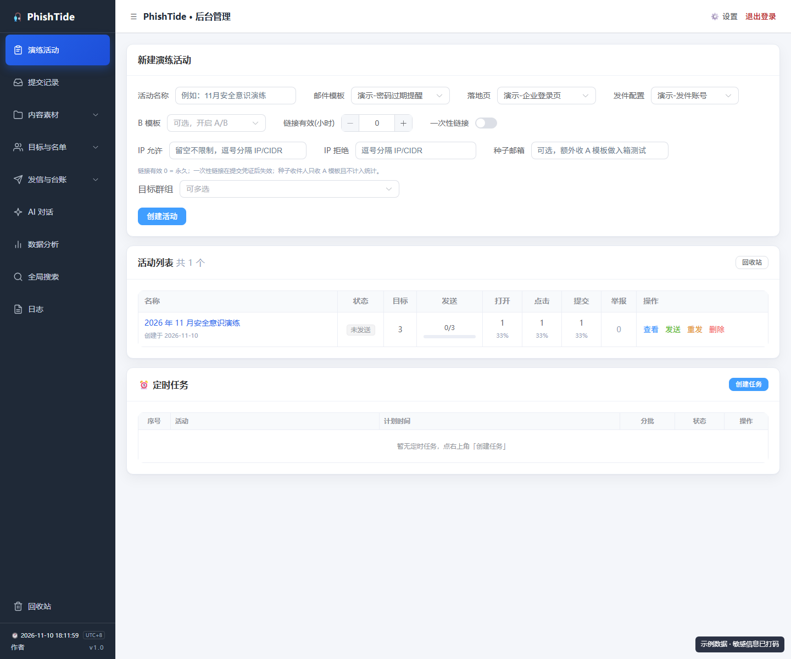

---

## 7. 第 6 步：第一次配置

### 7.1 设置对外地址

邮件里的落地页链接是按“对外地址”生成的。先确认它：

1. 右上角「⚙️ 设置」→「对外地址」
2. 填：`https://你的服务器IP:8443`
   - 如果有域名，填 `https://你的域名`（需要 nginx/Caddy 真证书，见第 12 节）
3. 点「保存对外地址」

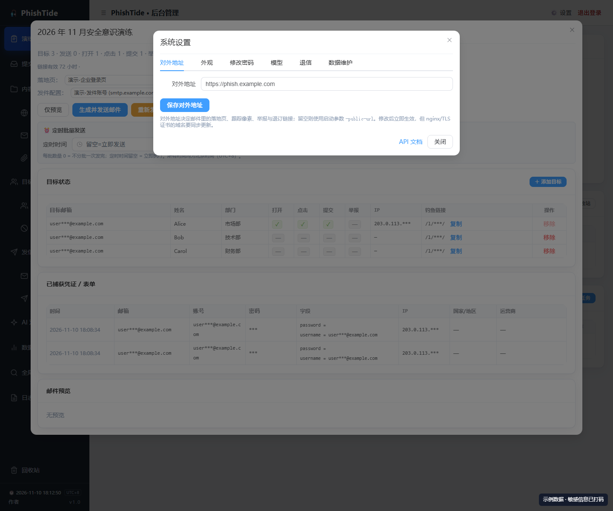

> 换服务器/IP 时只改这里即可，不用重启。

### 7.2 新建目标群组

左侧「目标与名单 → 目标群组」：

1. 群组名称：例如 `2026 年 11 月演练`
2. 目标 CSV：每行一个收件人，格式：
   ```
   email,first_name,last_name,department,position
   alice@example.com,Alice,Zhang,市场部,经理
   bob@example.com,Bob,Li,技术部,工程师
   ```
3. 点「创建群组」

也可以点「选择 CSV 文件」导入。

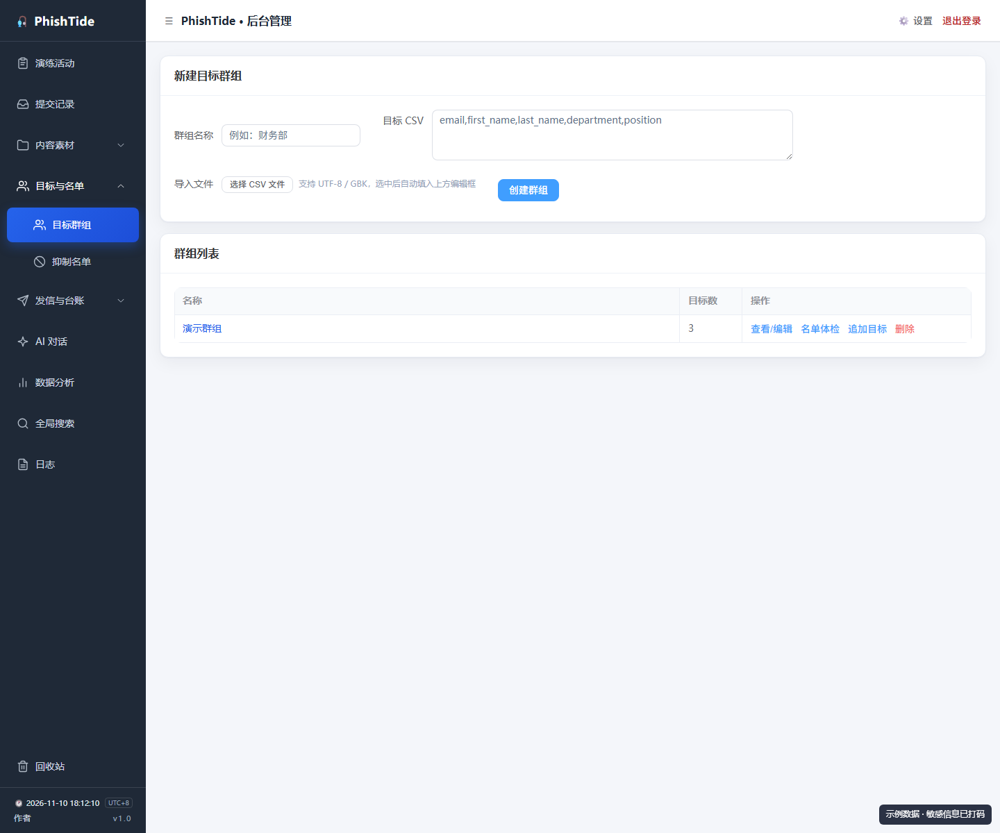

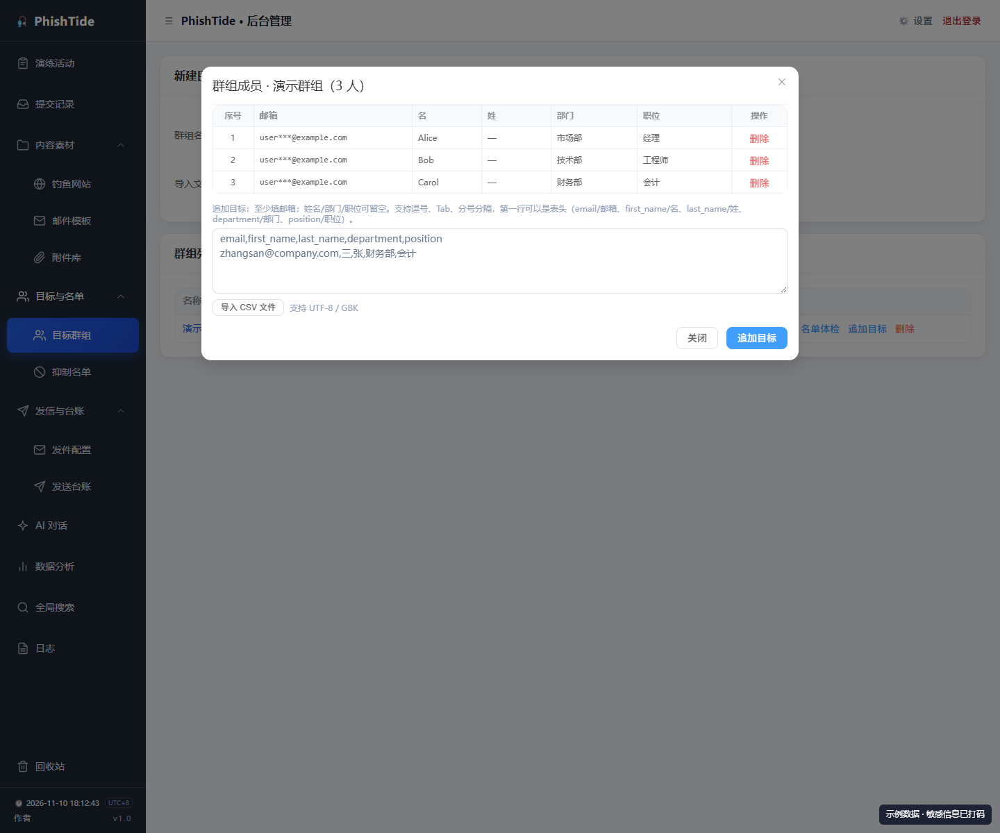

### 7.3 新建邮件模板

左侧「内容素材 → 邮件模板」：

- 名称：`密码过期提醒`
- 主题：`【演练】您的邮箱密码即将过期`
- HTML 正文里保留这些占位符：
  - `{{.FirstName}}`、`{{.LastName}}`、`{{.Email}}`
  - `{{.TrackingURL}}`：收件人专属落地页链接（**必须放**）
  - `{{.TrackingPixel}}`：跟踪像素（**必须放**）
- 保存。

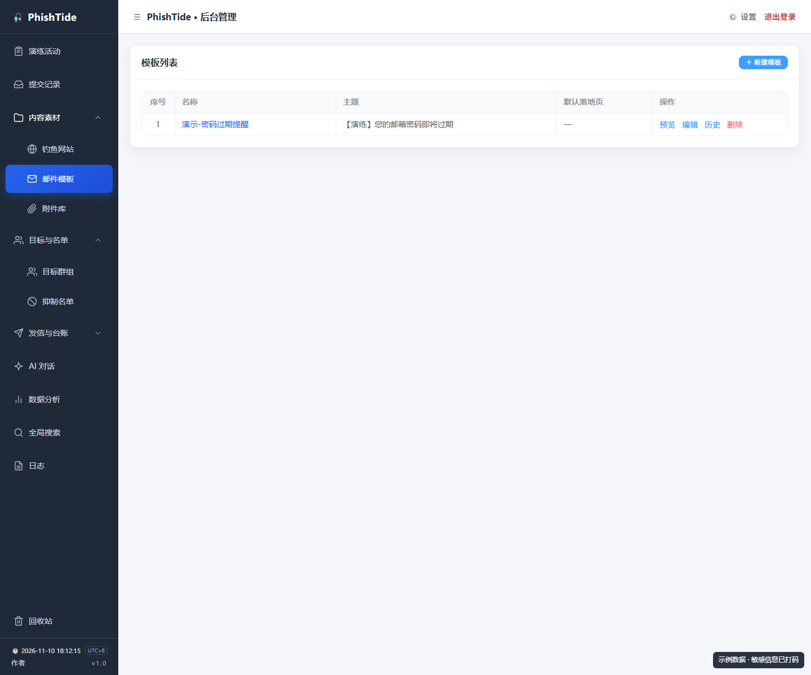

### 7.4 新建落地页

左侧「内容素材 → 钓鱼网站」：

- 可以用内置模板、导入 HTML、克隆真实站点、或建反向代理页。
- 表单 `action` 必须是 `__SUBMIT_URL__`（平台会自动改写）。
- 保存后平台会自检；有错误按提示修。

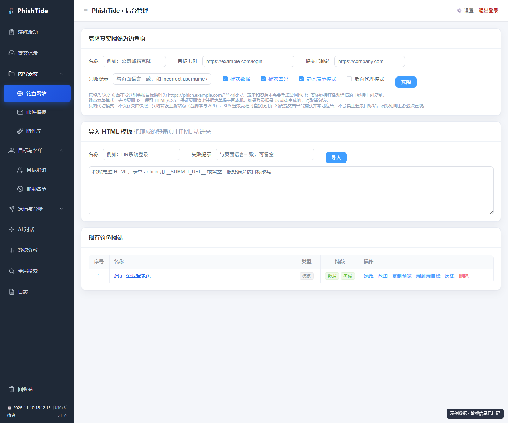

### 7.5 新建发件账号

左侧「发信与台账 → 发件配置」：

- SMTP 主机：例如 `smtp.qq.com`
- 端口：QQ 邮箱 `465` + SSL，或 `587` + STARTTLS
- 用户名：完整邮箱
- 密码：邮箱授权码（不是登录密码）
- 点「保存」
- 下面可以点「检查」做 SPF/DKIM/DMARC 检查

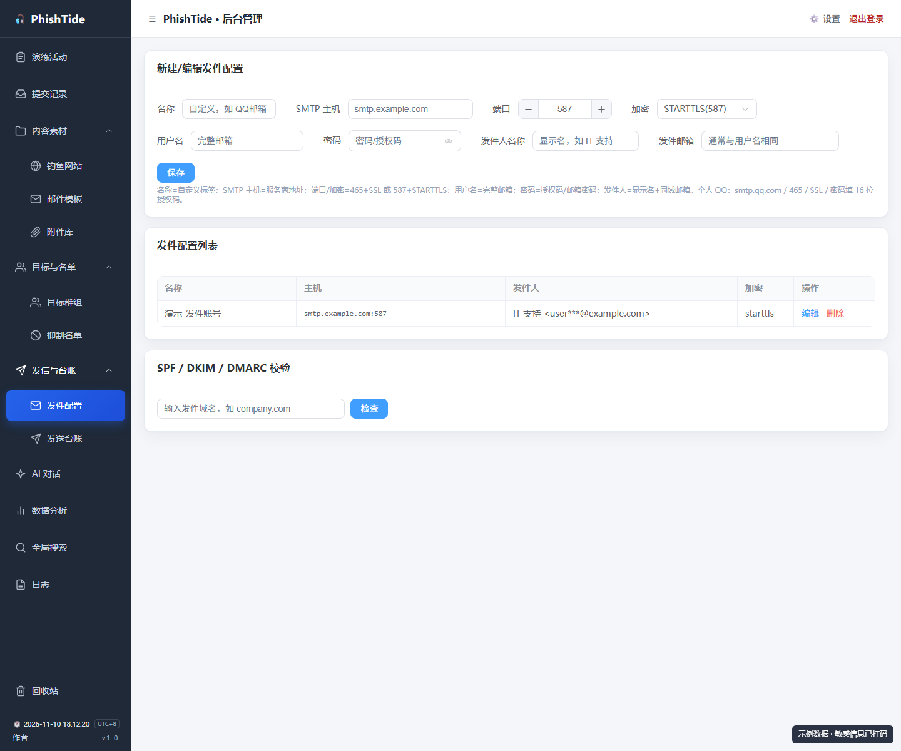

### 7.6 新建活动并发送

左侧「演练活动」：

1. 活动名称
2. 选择邮件模板、落地页、发件配置、目标群组
3. 链接有效期可以填 `72` 小时；一次性链接按需打开
4. 点「创建活动」
5. 在活动列表点「查看」→「生成并发送邮件」
6. 控制台会弹确认框，确认后才真正发送


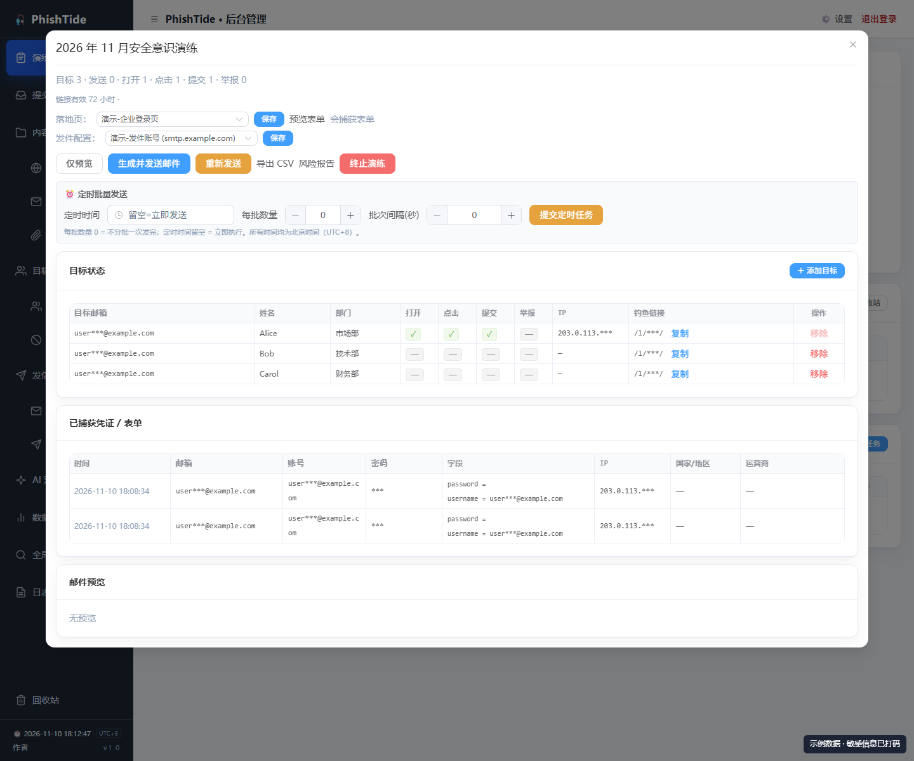

> 发送是**两段式**：先准备，操作员点“确认发送”后才发信。

### 7.7 看结果

- 「提交记录」：谁提交了账号密码、表单字段、IP
- 「数据分析」：打开/点击/提交漏斗、来源 IP
- 「发送台账」：每封信的发送记录（活动删除后仍在）
- 活动详情里的「风险报告」：个人/部门风险评分

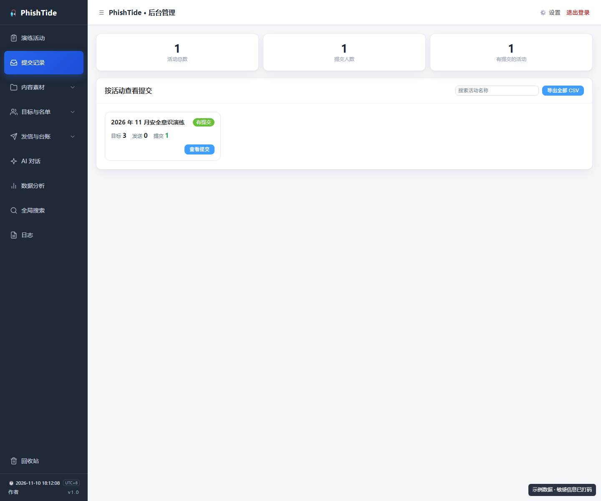

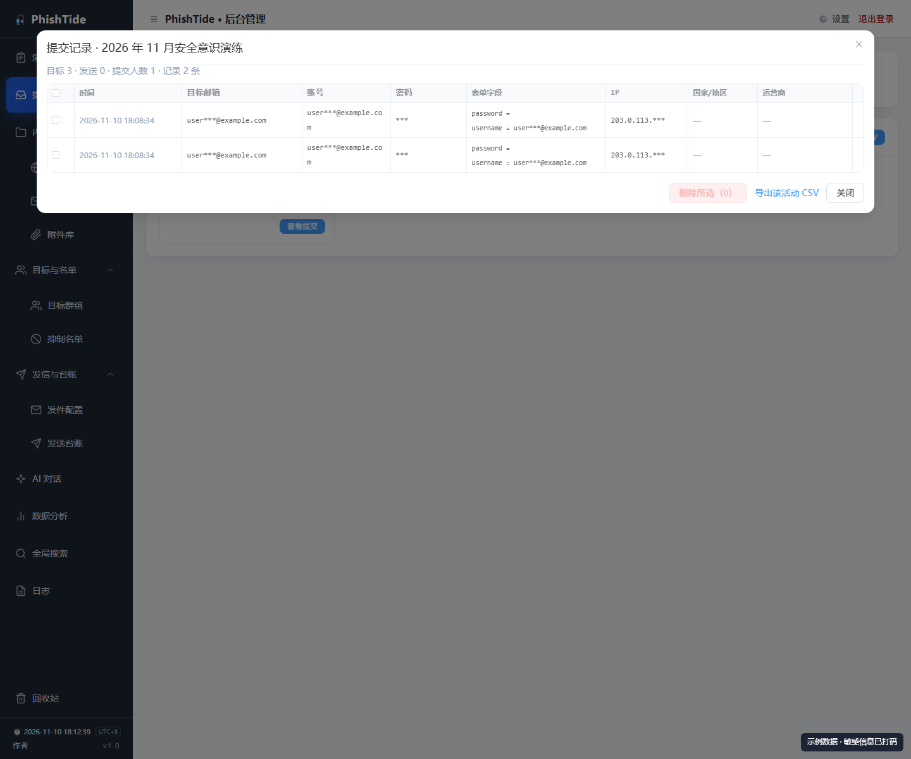

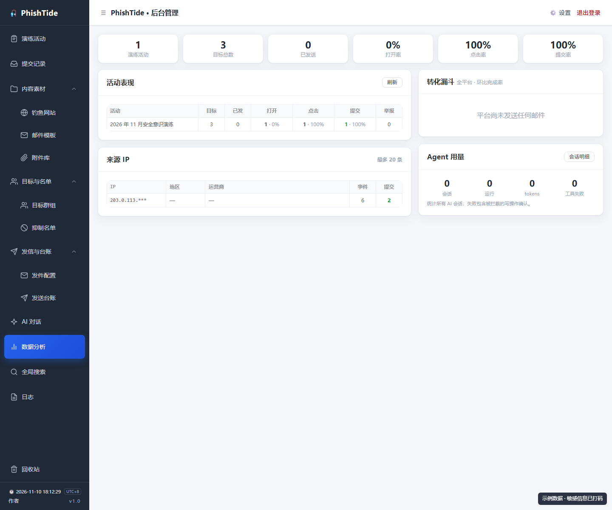

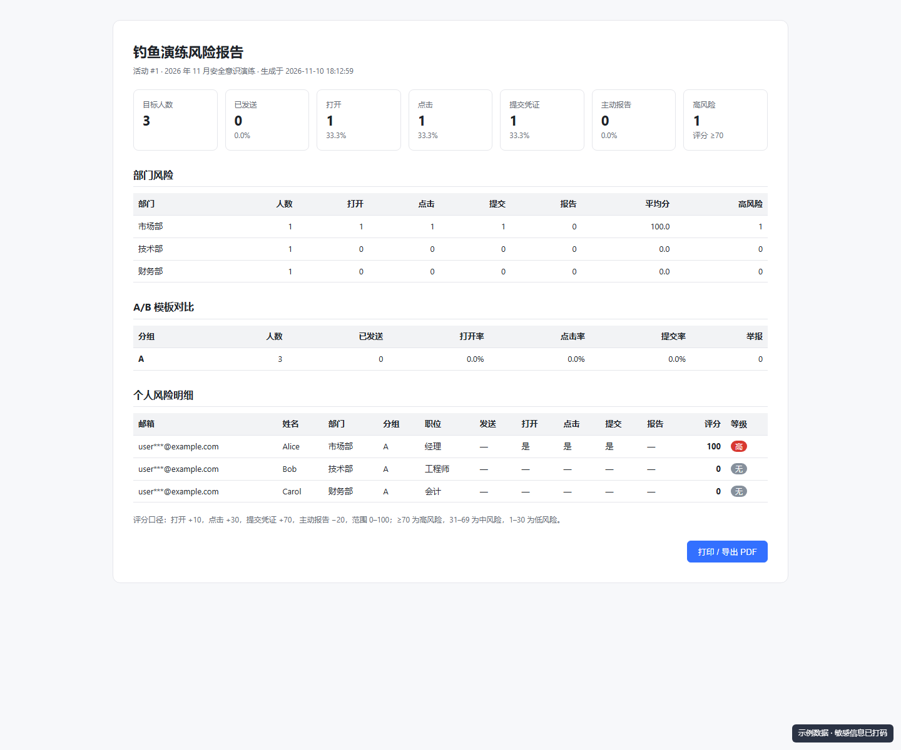

---

## 8. 日常管理命令

```bash
# 看服务状态（应该是 active (running)）
systemctl status phishsim

# 重启
systemctl restart phishsim

# 停止
systemctl stop phishsim

# 看实时日志（Ctrl+C 退出）
journalctl -u phishsim -f

# 看最近 100 行日志
journalctl -u phishsim -n 100 --no-pager
```

数据目录：`/opt/phishsim/data`（SQLite 数据库、`secret.key`、TLS 证书、背景图）。

配置文件：`/etc/phishsim.env`（只有 root 能读）。

---

## 9. 备份

```bash
# 停服务后复制整个数据目录（最简单）
systemctl stop phishsim
cp -a /opt/phishsim/data /root/phishsim-data-$(date +%F)
systemctl start phishsim
```

> 必须备份 `data/secret.key`，否则加密的密码/表单无法解密。
> SQLite 模式下复制整个 `data/` 目录就是完整备份；用 MySQL 时可以配合 `deploy/backup-mysql.sh` 做定期 `mysqldump`（保留最近 14 份）。

---

## 10. 升级

```bash
# 1. 备份 data 目录
# 2. 下载新的一键包或新的 phishsim-linux-amd64
# 3. 替换二进制
systemctl stop phishsim
cp /root/phishsim-linux-amd64 /opt/phishsim/phishsim
chmod 755 /opt/phishsim/phishsim
systemctl start phishsim
```

数据库会在启动时自动迁移。

---

## 11. 卸载

```bash
cd /root/phishsim-oneclick-linux-amd64
sudo ./uninstall.sh          # 停止并删除服务，保留 /opt/phishsim/data
sudo ./uninstall.sh --purge  # 连数据库、密钥、证书一起删
```

---

## 12. 可选：域名 + 真证书

默认用 IP + 自签证书，浏览器会警告。想要“正规 HTTPS”：

1. 域名 A 记录指向服务器 IP
2. 服务器安装 nginx 或 Caddy
3. 用 Let's Encrypt 签证书（80/443 被占用时用 DNS-01）
4. nginx/Caddy 反向代理到 `127.0.0.1:8443`
5. 后台「设置 → 对外地址」改成 `https://你的域名`
6. 建议在 nginx/Caddy 里把 `/__admin` 限制为你的固定 IP 或 VPN
7. 反代跑通后，在云安全组只放行 443（和必要的 22 等），关掉 8443 的公网访问，避免绕过反代直接访问后台

详细配置见 `docs/zh-CN/DEPLOYMENT.md`。

---

## 13. 可选：MySQL

默认 SQLite 足够小规模使用。要用 MySQL：

1. 在服务器安装 MySQL 8
2. 建库和最小权限账号：
   ```sql
   CREATE DATABASE phishsim CHARACTER SET utf8mb4 COLLATE utf8mb4_unicode_ci;
   CREATE USER 'phish'@'127.0.0.1' IDENTIFIED BY '强密码';
   GRANT ALL PRIVILEGES ON phishsim.* TO 'phish'@'127.0.0.1';
   ```
3. 重新安装并传入 DSN：
   ```bash
   sudo ./install.sh --mysql-dsn 'phish:强密码@tcp(127.0.0.1:3306)/phishsim?charset=utf8mb4&parseTime=true&loc=Local'
   ```

---

## 14. 常见问题

| 现象 | 原因 / 处理 |
| --- | --- |
| 浏览器打不开，提示“无法访问此网站” | 安全组没放行 8443；或服务没启动（`systemctl status phishsim`） |
| 浏览器提示“证书不受信任” | 自签证书，正常；点“高级 → 继续前往” |
| 登录提示 401 | 密码错；看 `/etc/phishsim.env` 里的 `PHISH_ADMIN_PASS` |
| 登录提示 429 | 15 分钟内失败 5 次被锁；等 15 分钟或重启服务（锁定在内存） |
| 落地页打开是 404 | 链接里的 token 不对/活动已删除；从活动详情复制新的链接 |
| 邮件里的链接是 `127.0.0.1` | 后台「设置 → 对外地址」没改成公网 IP/域名 |
| 克隆页空白 | 站点是 SPA；改用“反向代理页”，或重新克隆 |
| 截图/端到端自检失败 | 服务器没装 Chrome；`sudo apt install chromium-browser` |
| 发送失败 | 看活动详情「发送失败」；常见是授权码、465/587、TLS 模式不对 |
| 磁盘占用变大 | 设置保留期；提交/事件会按 `PHISH_RETENTION_DAYS` 清理 |

---

## 15. 安全建议（重要）

- 一键安装默认把后台暴露在 `https://IP:8443/__admin`，**请务必使用强密码**（脚本已随机生成）。
- 生产环境建议把 `/__admin` 限制为你的固定 IP/VPN，或只通过 SSH 隧道访问。
- 不要长期把后台直接暴露公网；演练结束停服务或关端口。
- 定期备份 `data/`，尤其是 `secret.key`。
- 设置数据保留期；演练结束后清理提交记录。
- 只对已授权的人员和目标使用。

---

## 16. 一键包与 Release 资产

| 文件 | 作用 |
| --- | --- |
| `phishsim` | Linux 二进制（已按平台编译） |
| `install.sh` | 一键安装脚本 |
| `uninstall.sh` | 卸载脚本 |
| `README.md` | 英文/中文快速说明 |
| `SHA256SUMS` | 校验和文件，**不在一键包内**，在 Release 页面和其他资产一起单独下载 |

校验下载：

```bash
# 在同时放着 .tar.gz 和 SHA256SUMS 的目录里执行（解压前）
sha256sum -c --ignore-missing SHA256SUMS
```

---

## 17. 让 AI 帮你部署（最省事）

如果你不想自己敲命令，可以把服务器和项目交给一个**能执行命令的 AI**（Cursor、Codex 或其他能执行命令的 AI），让它按一键包部署。

在 AI 的对话框里贴下面这段（把 `<...>` 换成你的）：

```
你是一台 Ubuntu 服务器的运维助手。
服务器：IP <服务器IP>，SSH 端口 22，用户 root，密码 <临时密码>
（或者 SSH 密钥路径 <私钥路径>）。
项目地址：https://github.com/shangdi-w/PhishTide

请按顺序执行，并告诉我每一步的结果：
1. 下载 Release 里的 phishsim-oneclick-linux-amd64.tar.gz
2. 解压并执行 sudo ./install.sh --public-url https://<服务器IP>:8443
3. 如果 ufw/安全组没放行，帮我放行 8443/tcp
4. 执行 curl -k https://127.0.0.1:8443/__admin/login，确认返回 200
5. 把后台地址、用户名、初始密码发给我

不要执行其他破坏性操作；完成后提醒我修改密码并撤销临时凭据。
```

安全提醒：

- 给 AI 用**临时密码**或**专用 SSH 密钥**，部署完立即修改密码/删除密钥。
- 不要把服务器密码粘贴到公开群聊或公开网页；只在你信任的本地 AI 会话里使用。
- 优先用能直接在你电脑上执行命令的 AI（Cursor / Codex），这样凭据不离开本机。
- 云厂商安全组 AI 改不了，需要你在控制台手动放行 8443。
- 部署完成后：改后台密码、关掉临时 SSH 密码、只保留必要端口。

---

## 18. SSH 隧道小白版

隧道就是“把服务器上的端口借到本机用”，不需要装 frp/ngrok。

### 18.1 只访问后台：本地转发

程序跑在服务器上（一键包默认），但不想把 `/__admin` 暴露公网：

```bash
ssh -N -L 9443:127.0.0.1:8443 root@你的服务器IP
```

- `-N`：只建隧道，不打开远程 shell。
- `-L 9443:127.0.0.1:8443`：把本机 `9443` 转发到服务器的 `8443`。
- 保持这个窗口开着，然后浏览器打开：

```
https://127.0.0.1:9443/__admin
```

本机 `9443` 被占用就换 `9444`；服务器 `8443` 不要改。

### 18.2 程序在本机，服务器做公网入口：反向转发

程序跑在你自己的 Windows 电脑上，想让公网访问：

```bash
ssh -N -R 127.0.0.1:18081:127.0.0.1:8443 root@你的VPS
```

- `-R`：把 VPS 的 `18081` 转发回本机的 `8443`。
- 然后在 VPS 上用 nginx/Caddy 把公网 443（或自定义端口）反代到 `127.0.0.1:18081`。
- 本机不能关机，隧道断了公网入口就断。

### 18.3 保持稳定

- Windows 可以用任务计划程序开机运行 `ssh -N -R ...`。
- Linux 可以用 `autossh -M 0 -N -R ...`。
- 加 `-o ServerAliveInterval=30 -o ServerAliveCountMax=3` 让断线自动恢复。

### 18.4 常见问题

| 现象 | 处理 |
| --- | --- |
| `bind: Address already in use` | 本机端口被占用，把 `9443` 换成 `9444` |
| `Permission denied` | SSH 密码/密钥不对 |
| 隧道通了但后台 404 | 地址写错；后台是 `/__admin`，公网入口可能故意 404 |
| 连接很快断开 | 服务器 sshd 关闭了 TCP 转发；检查 `AllowTcpForwarding` |
| 浏览器证书警告 | 自签证书，点「高级 → 继续」 |

---

## 19. AI 特色：生成邮件、配置发件、一键发送

配置好「设置 → 模型」后，AI 不只是聊天，它可以直接操作平台：

- **生成邮件**：“帮我生成一封密码过期提醒邮件，保存为模板。”
- **生成落地页**：“照这个参考站做一个登录页” / “把现有落地页改成深色企业风格。”
- **配置发件账号**：“帮我建一个 QQ 邮箱发件账号，邮箱 xxx，授权码 xxx，465 SSL。”
- **建群组/活动**：“用这个群组和模板创建活动，先干跑。”
- **一键发送**：“没问题就发送。” AI 会调用 `send_campaign` 发起确认，你点「确认发送」后才真正发信。
- **诊断**：“这个活动为什么没发出去？” AI 会查发送台账、失败分类、退信、日志。
- **收退信/风险报告**：“收一下退信并汇总” / “生成这个活动的风险报告。”

安全机制：

- 覆盖同名模板/落地页/发件账号、高危操作、多步任务会弹确认。
- 读过外部网页的会话会被标记为“污点”，后续写操作需要确认。
- 发送是**两段式**：AI 只准备，操作员确认后才发。
- 真实测试截图见 [后台功能图解 21 节](UI-GUIDE.md#21-ai-一键发送实战)。

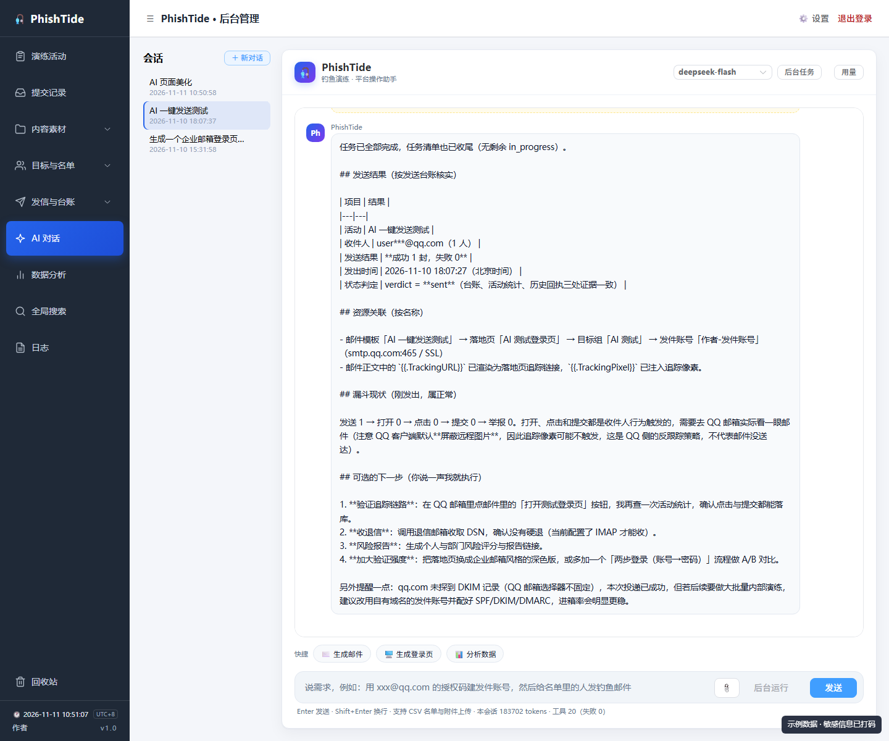

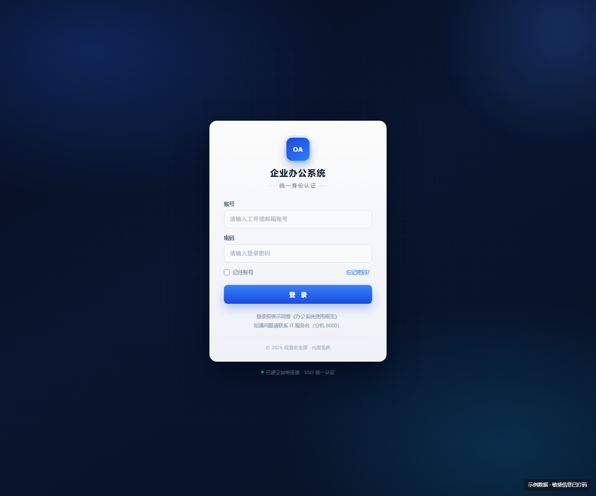

---

<p align="center">
  <br>
  <strong>还有问题？扫码联系作者</strong>
</p>
