<p align="center">
  <br>
  <strong>遇到问题？扫码联系作者</strong>
</p>

# PhishTide 后台功能图解（逐页说明）

本文用一套**临时演示实例**的截图，逐个说明后台每个菜单能做什么、怎么操作、要注意什么。

> 截图中的邮箱、IP、密码、URL、Key、服务器路径、活动链接都已打码；实际界面以你部署的版本为准。
> 演示数据：1 个活动、3 个收件人、1 次提交、4 个模板/落地页。

---

## 目录

1. [登录](#1-登录)
2. [演练活动](#2-演练活动)
3. [活动详情](#3-活动详情)
4. [提交记录](#4-提交记录)
5. [目标群组](#5-目标群组)
6. [钓鱼网站（落地页）](#6-钓鱼网站落地页)
7. [邮件模板](#7-邮件模板)
8. [附件库](#8-附件库)
9. [发件配置](#9-发件配置)
10. [发送台账](#10-发送台账)
11. [抑制名单](#11-抑制名单)
12. [AI 对话](#12-ai-对话)
13. [数据分析](#13-数据分析)
14. [全局搜索](#14-全局搜索)
15. [日志](#15-日志)
16. [系统设置](#16-系统设置)
17. [风险报告](#17-风险报告)
18. [回收站](#18-回收站)
19. [API 文档](#19-api-文档)
20. [一键部署](#20-一键部署)
21. [AI 一键发送实战](#21-ai-一键发送实战)

---

## 1. 登录

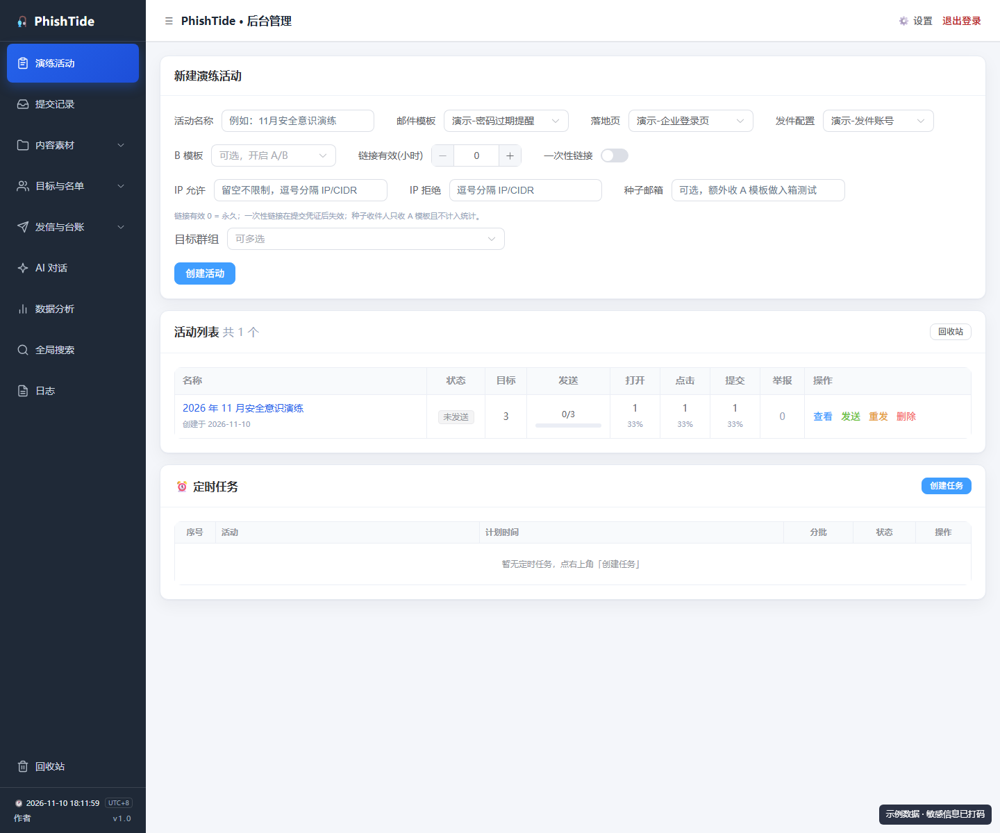

- 地址：`https://你的IP:8443/__admin`
- 用户名默认 `admin`，密码是启动参数或安装脚本生成的。
- 第一次登录会看到自签证书警告，点「高级 → 继续前往」即可。
- 连续输错 5 次会锁定当前 IP 15 分钟。

---

## 2. 演练活动


页面分三块：

**① 新建演练活动**

| 字段 | 说明 |
| --- | --- |
| 活动名称 | 自己看得懂即可，例如“11 月安全意识演练” |
| 邮件模板 | 必选，决定邮件主题和正文 |
| 落地页 | 必选，决定点击链接后打开的页面 |
| 发件配置 | 可选；不选只能预览，不能真正发信 |
| B 模板 / 一次性链接 | 可选，做 A/B 或阅后即焚 |
| 链接有效（小时） | `0` = 永久；到期链接返回 410 |
| IP 允许/拒绝 | 逗号分隔 IP/CIDR；拒绝优先 |
| 种子邮箱 | 额外给这些邮箱发 A 模板，不计统计 |
| 目标群组 | 可多选，自动去重 |

**② 活动列表**

每行显示：目标数、发送进度、打开/点击/提交/举报率。
操作：`查看`（进详情）、`发送`、`重发`、`删除`（软删除进回收站）。

**③ 定时任务**

- 点「创建任务」可以指定时间、批量大小、批次间隔。
- 时间按北京时间（UTC+8）理解。
- 到点由后台调度器自动发送；可以取消。

---

## 3. 活动详情

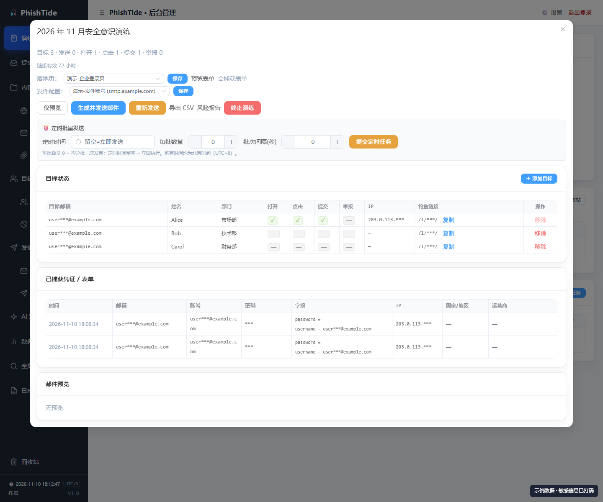

点活动列表的「查看」进入。这里是最常用的页面：

- **顶部统计**：目标 3、发送 0、打开 1、点击 1、提交 1、举报 0。
- **落地页 / 发件配置**：可以下拉换绑并保存。
- **操作按钮**：
  - `仅预览`：只渲染邮件，不发信。
  - `生成并发送邮件`：进入两段式确认（操作员点确认后才发）。
  - `重新发送`：对未发送/需要重发的目标再发。
  - `导出 CSV`：导出该活动的结果与提交。
  - `风险报告`：个人/部门风险评分。
  - `终止演练`：立刻停止，落地页变成维护页。
- **定时批量发送**：可在这里直接创建定时任务。
- **目标状态**：每个收件人的打开/点击/提交/举报、IP、专属链接；可以复制链接。
- **已捕获凭证 / 表单**：每次提交的账号、密码（打码）、全部字段、IP。
- **邮件预览**：发送前检查渲染效果。

> 发送前平台会强制复检落地页；页面自检不通过会拒绝发送。

---

## 4. 提交记录

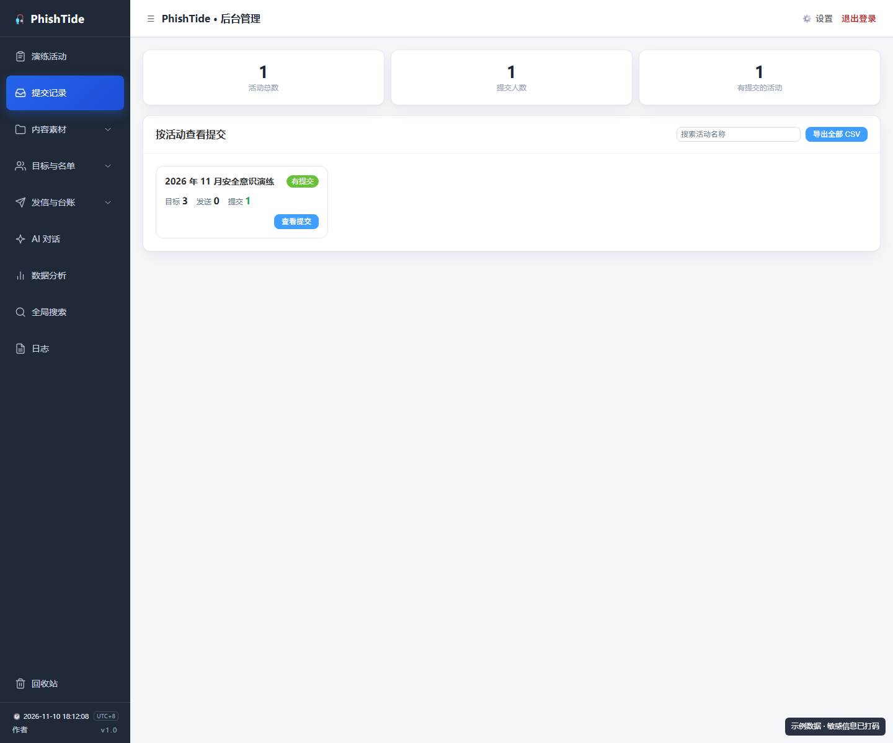

按活动分组展示“谁提交了”。

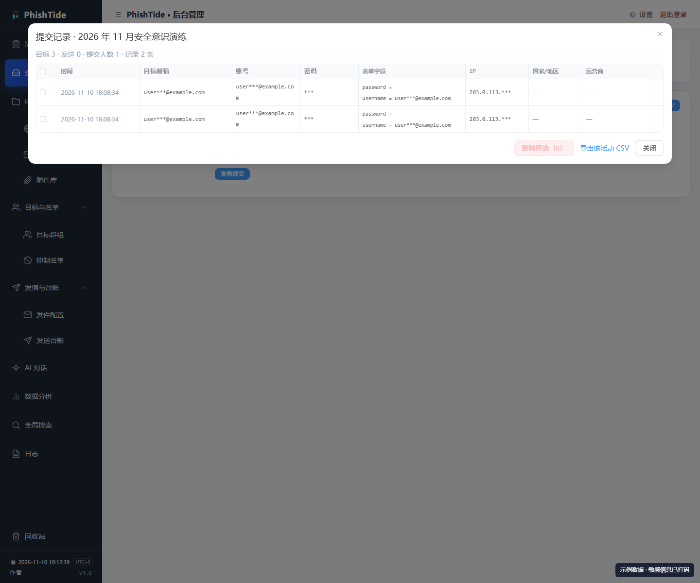

点「查看提交」打开明细表：

| 列 | 说明 |
| --- | --- |
| 时间 | 提交时间（北京时间） |
| 目标邮箱 | 哪个收件人 |
| 账号 / 密码 | 从表单字段提取的 username/password |
| 表单字段 | 其余字段原样保留 |
| IP / 国家 / 运营商 | 来源地址（离线 GeoIP，可选） |

- `导出该活动 CSV`：带 UTF-8 BOM，Excel 打开中文不乱码。
- 勾选后可批量删除；删除不可恢复。

---

## 5. 目标群组

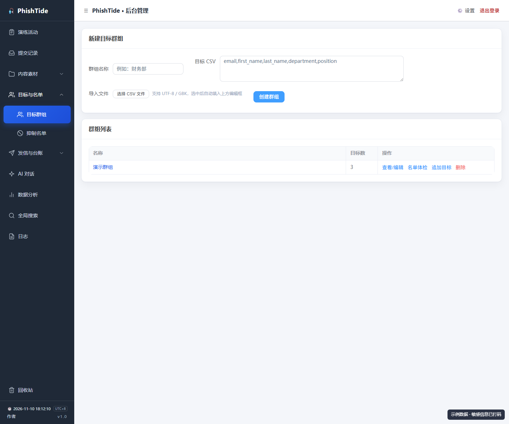

- **新建目标群组**：填名称 + CSV（表头支持 `email,first_name,last_name,department,position` 或中文）。
- 也可以点「选择 CSV 文件」导入（UTF-8/GBK）。
- 群组列表显示人数，操作：
  - `查看/编辑`：查看成员、追加目标。
  - `名单体检`：检查格式、重复、职能邮箱、一次性域名、MX。
  - `追加目标`：往这个群组继续加人。
  - `删除`：被活动引用时会拒绝。

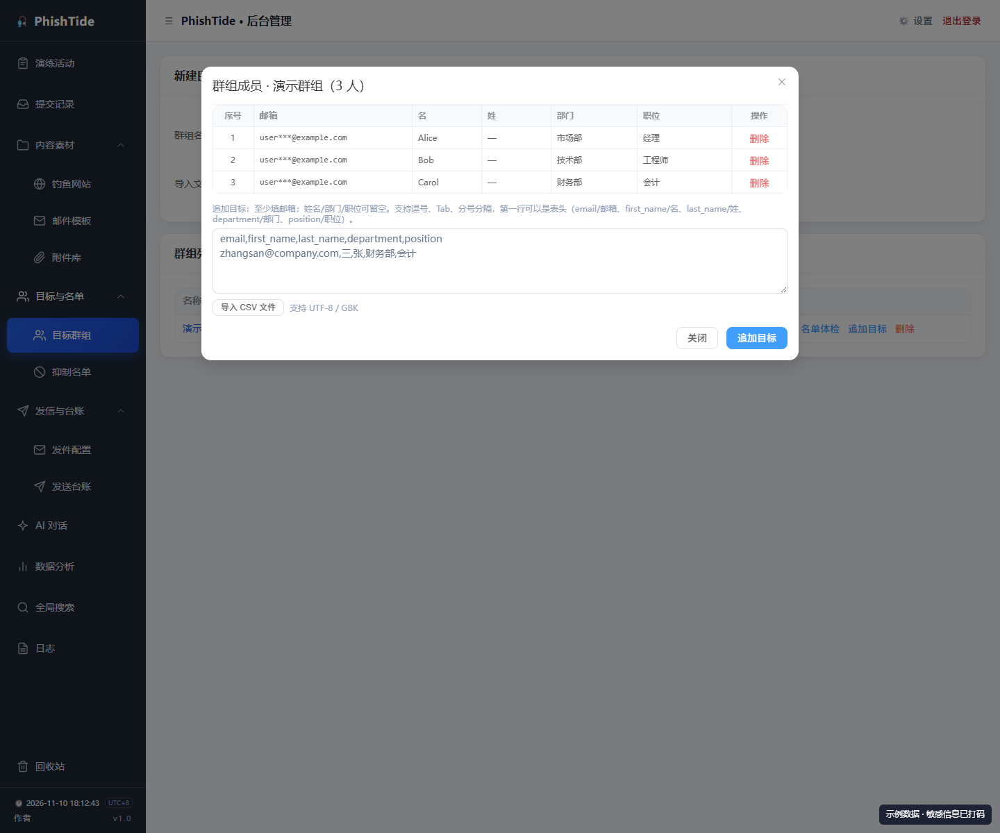

成员弹窗里可以看到每个人的邮箱、姓名、部门、职位，也可以直接粘贴 CSV 追加。

---

## 6. 钓鱼网站（落地页）

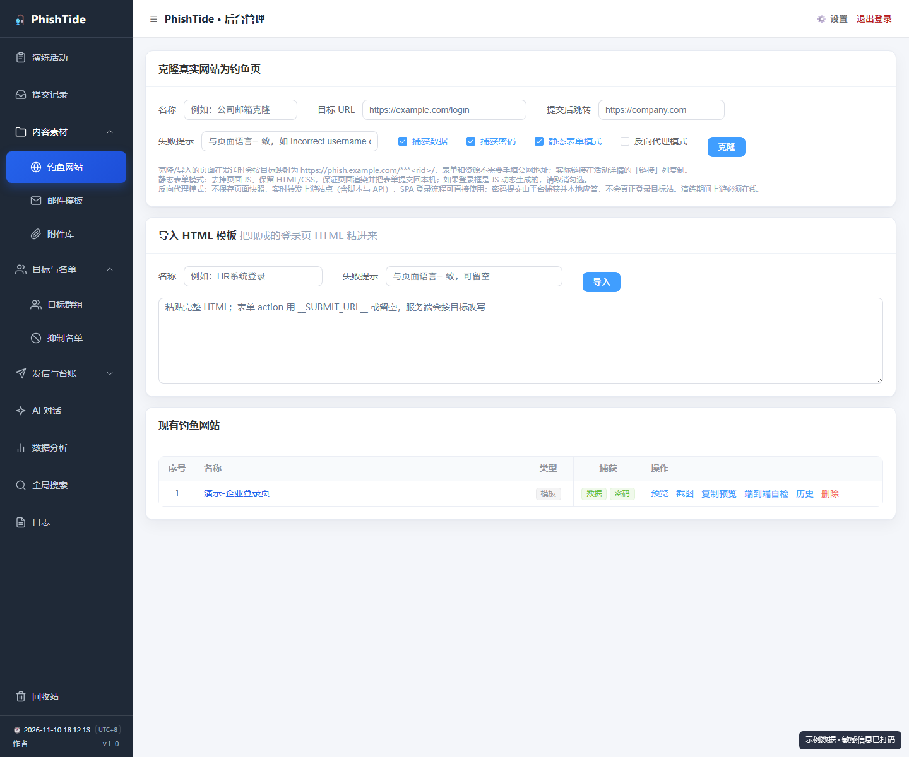

这里是“点击邮件链接后打开的页面”。支持四种来源：

| 方式 | 适合 |
| --- | --- |
| 内置模板 | 快速开始 |
| 导入 HTML | 自己写好页面 |
| 克隆站点 | 想把真实登录页 1:1 复制下来 |
| 反向代理页 | 复杂 SPA/SSO，需要实时上游 |

列表操作通常包括：`预览`、`截图`、`端到端自检`、`历史版本`、`重命名`、`删除`。

- 表单 `action` 必须是 `__SUBMIT_URL__`，平台会在服务时改写。
- 克隆/代理页有“凭证捕获”和“密码捕获”开关。
- 保存后平台会自动自检；有错误按提示修。
- 反向代理页要求上游一直在线；密码提交会被平台拦截并本地应答，不会真的登录目标站。

---

## 7. 邮件模板

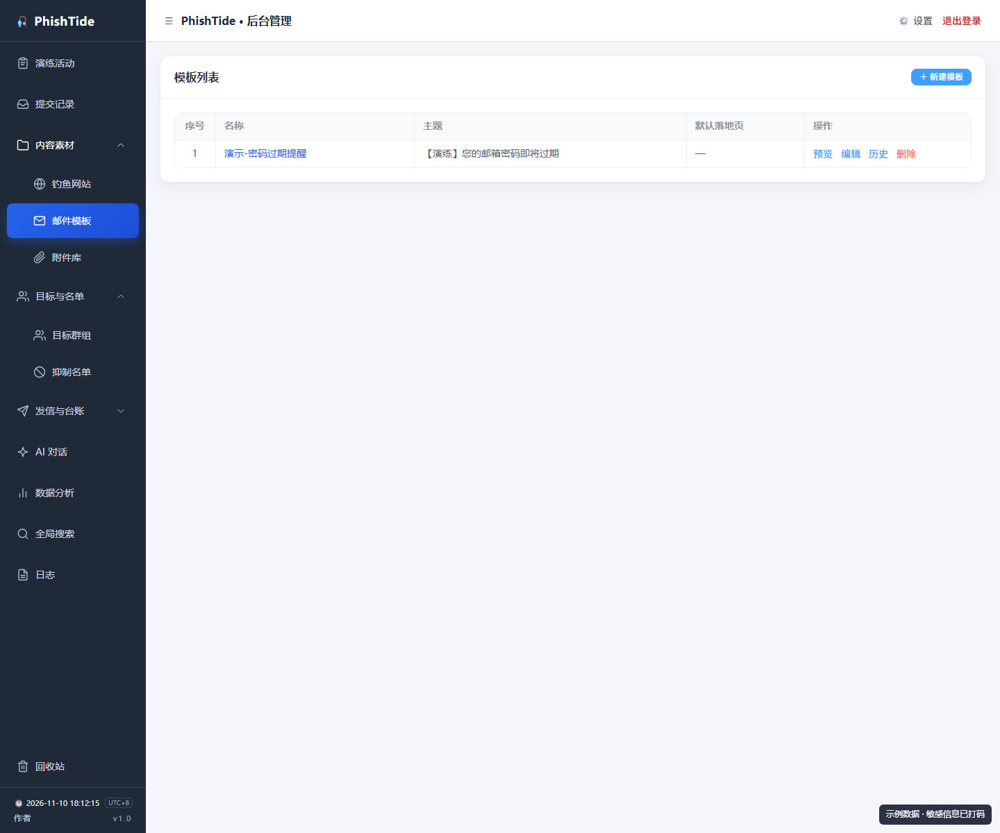

- 新建/编辑模板：名称、主题、HTML、纯文本。
- 可用变量：
  `{{.FirstName}}` `{{.LastName}}` `{{.Email}}` `{{.Position}}`
  `{{.TrackingURL}}` `{{.TrackingPixel}}` `{{.FromName}}` `{{.FromEmail}}`
- `{{.TrackingURL}}` 必须放在正文里，否则收件人点不到落地页。
- `{{.TrackingPixel}}` 用于统计打开。
- 支持挂附件（每模板最多 5 个、单文件 ≤ 5MB）。
- 每次保存都会留历史版本，可回滚。

---

## 8. 附件库

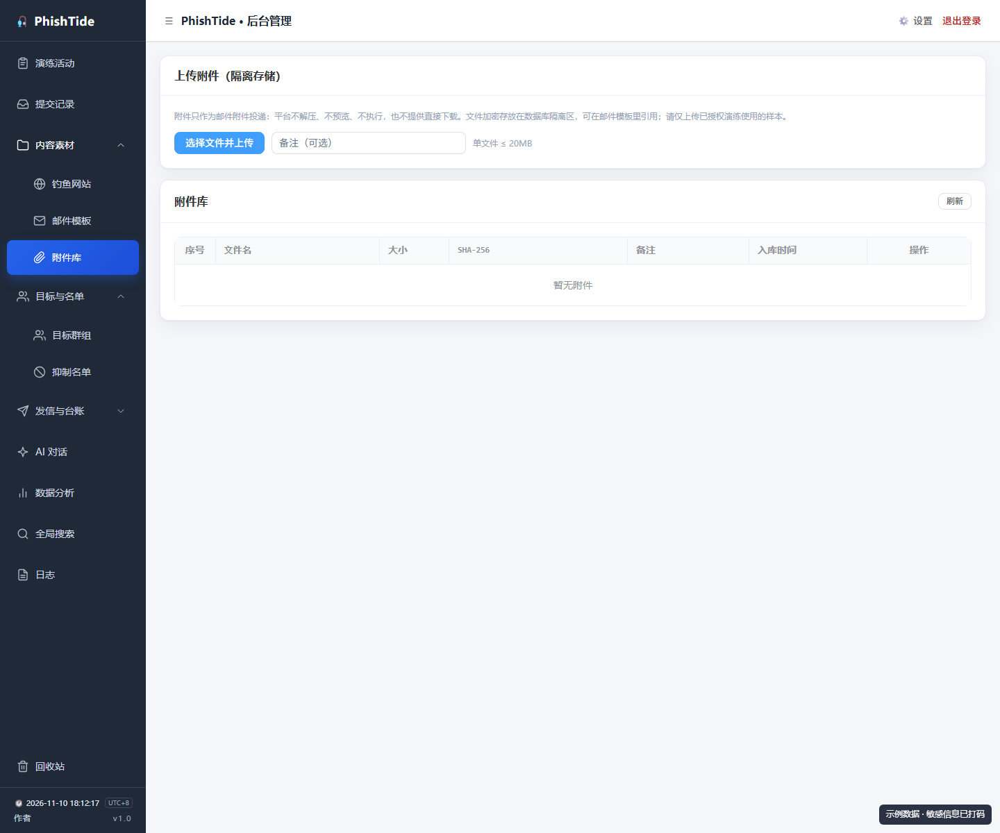

- 上传任意附件（单文件 ≤ 20MB），只作为邮件附件投递。
- 平台**不解压、不预览、不执行**，也不提供原始下载接口。
- 文件加密存放在数据库；列表只显示名称、大小、SHA-256、备注。
- 点「挂到模板」把副本写到邮件模板，随信发送。

---

## 9. 发件配置

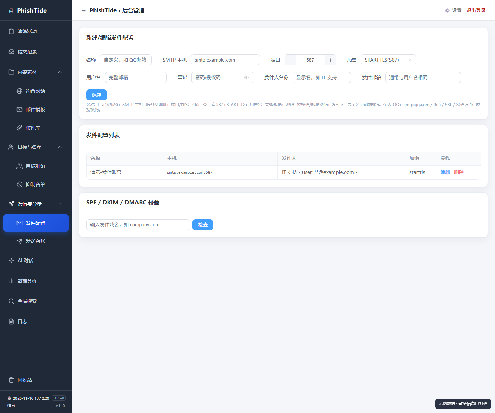

- 填 SMTP 主机、端口、用户名、密码/授权码、发件人名称/邮箱。
- 465 端口必须用 SSL；587 用 STARTTLS；本机中继才允许 `none`。
- 页面下方有 **SPF / DKIM / DMARC 校验**：输入发件域名，点「检查」。
- 保存后可以在活动里绑定；发送前平台会用该账号发信。
- 密码加密存储，列表不回显；需要查看时点眼睛图标（会记日志）。

---

## 10. 发送台账

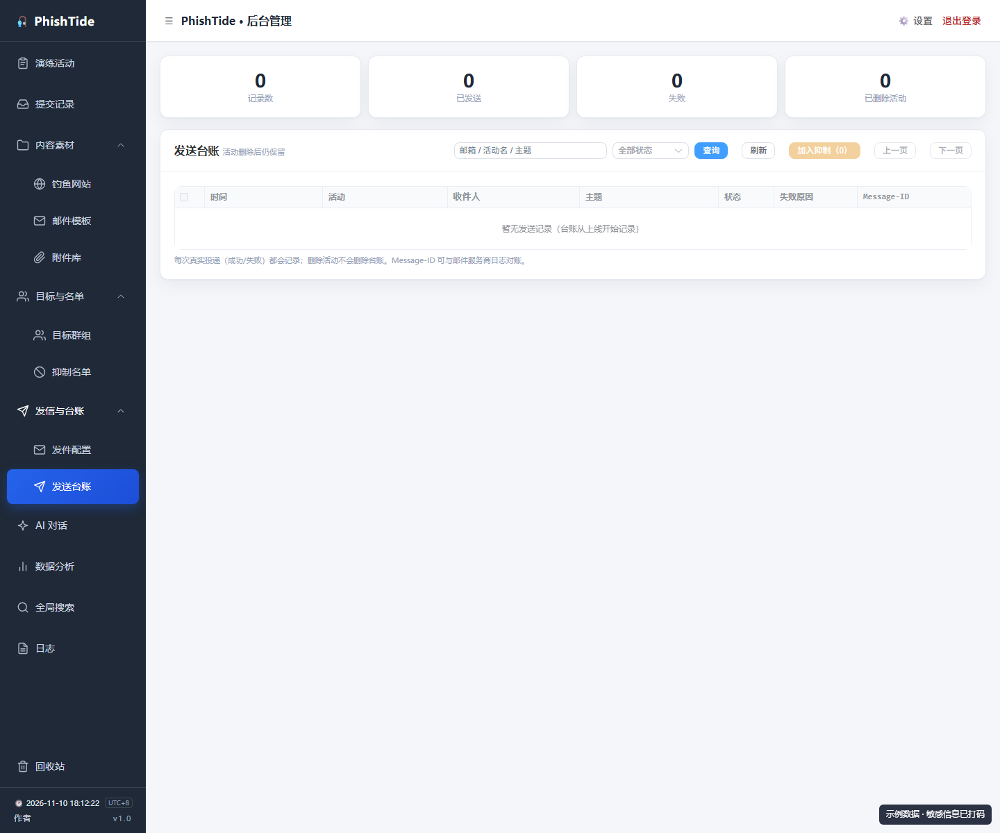

- 每次真实投递（成功或失败）都会写一行，**活动删除后仍保留**。
- 可按邮箱、活动名、主题、状态筛选。
- 记录 Message-ID，方便和服务商日志对账。
- 可勾选收件人一键加入抑制名单。
- 回答“邮件到底发没发出去”时，以台账 + 活动统计 + 历史回执为准。

---

## 11. 抑制名单

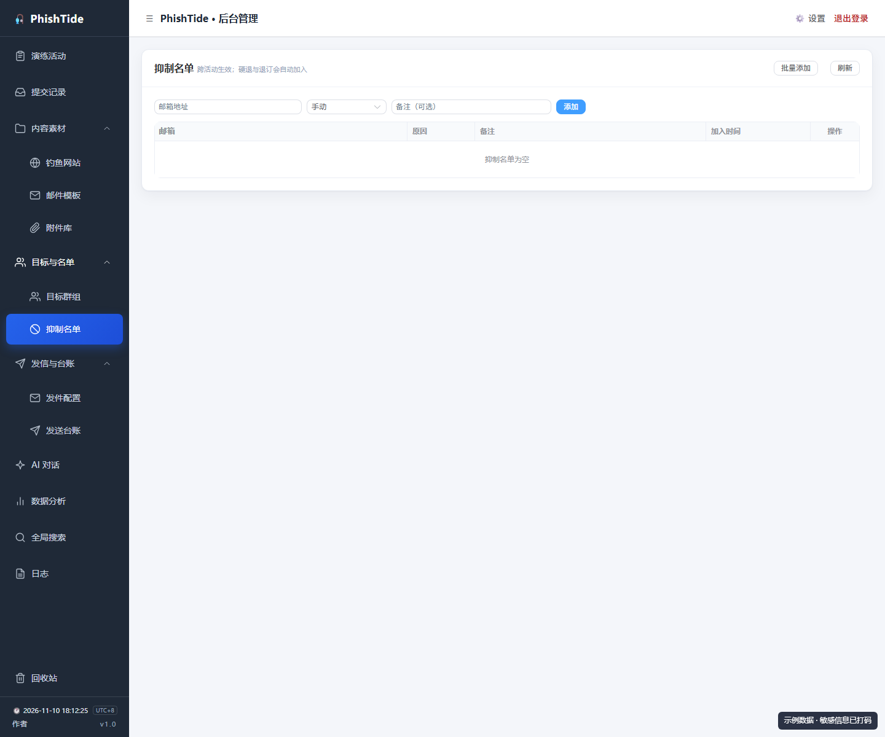

- 跨活动的不发名单：手动添加、硬退自动加入、退订链接自动加入、投诉。
- 发送时命中抑制名单会直接跳过，并在结果里计入 `suppressed`。
- 支持批量添加（换行/逗号/分号分隔）和批量删除。
- 硬退（5.x.x）通常应永久抑制；软退（4.x.x）可以等下一轮再发。

---

## 12. AI 对话

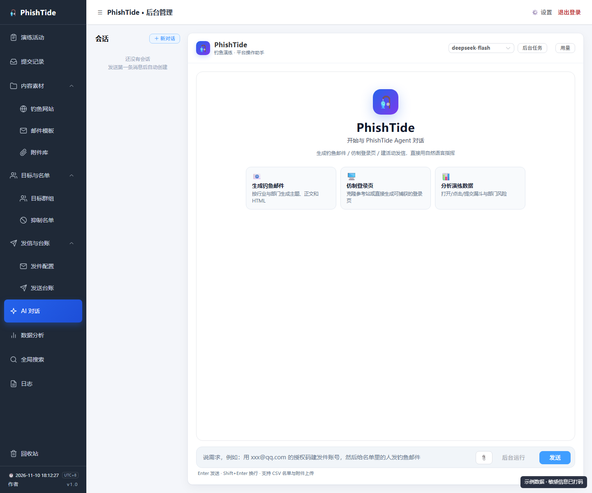

- 需要先在「设置 → 模型」配置 OpenAI 兼容端点（Base URL / Key / 模型）。
- 助手带 **57 个工具**，可以直接建群组、模板、落地页、活动、发信、查台账、看日志等。
- 安全机制：
  - 覆盖同名对象、高危写操作、多步任务会弹确认。
  - 读过外部网页的会话会被标记为“污点”，后续写操作需要确认。
  - 发送是两段式：助手只准备，操作员点「确认发送」才发。
- 支持：
  - 任务清单（多步任务自动跟踪）
  - 后台任务（关页面也继续，可定时）
  - 只读子代理（并行核验）
  - 长期记忆（偏好/事实/任务）
- 输入框支持上传 CSV 名单、邮件附件、图片、PDF。

> 不配置 LLM 也能用平台，只是没有 AI 对话。

---

## 13. 数据分析

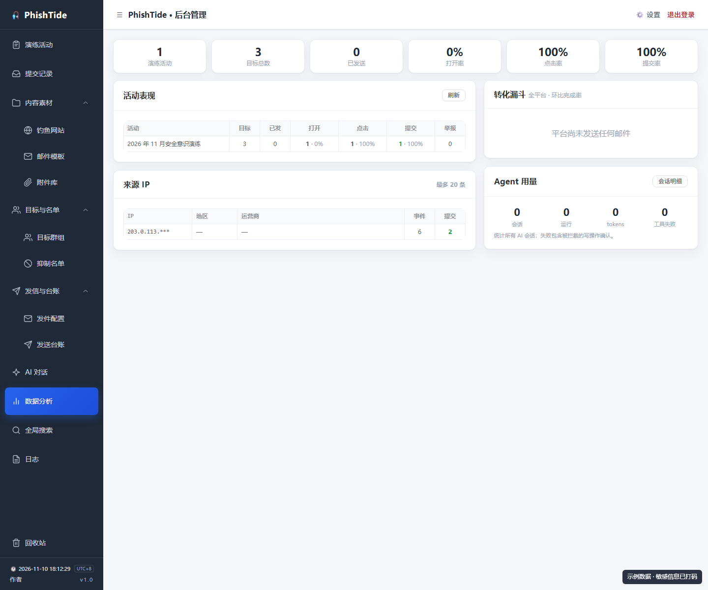

- 顶部卡片：演练活动数、目标总数、已发送、打开率、点击率、提交率。
- **活动表现**：每个活动的目标/已发/打开/点击/提交/举报。
- **转化漏斗**：全平台发送 → 打开 → 点击 → 提交 → 举报。
- **来源 IP**：按 IP 汇总事件与提交次数（内网/公网/国家/运营商）。
- **Agent 用量**：会话数、运行次数、tokens、工具失败；点「会话明细」看每个会话。

---

## 14. 全局搜索

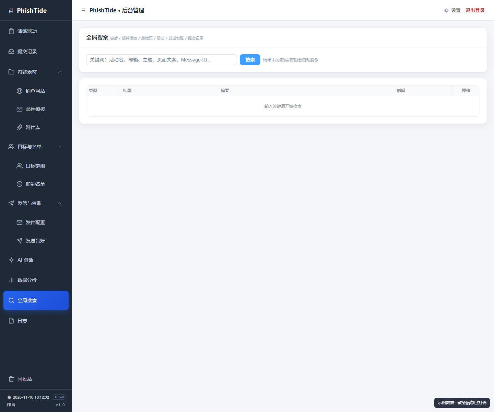

- 左侧「🔍 全局搜索」跨模块检索：
  历史会话、邮件模板、落地页、活动、发送台账、提交记录。
- 结果带类型、摘要、时间、「打开」跳转。
- 摘要里的密码/密钥由后端脱敏。
- 对应 Agent 工具 `global_search`。

---

## 15. 日志

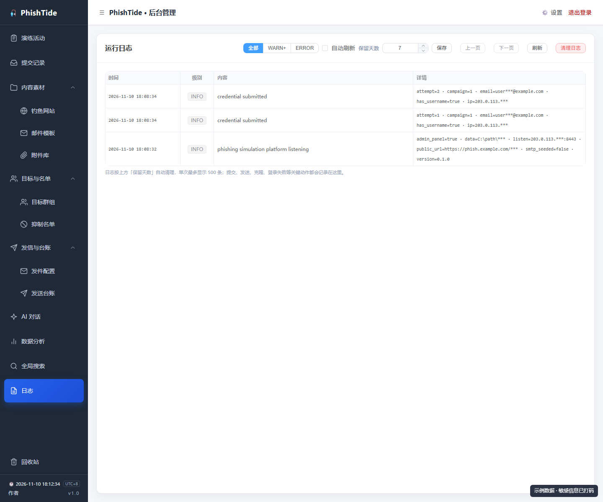

- 运行日志，支持 `全部 / WARN+ / ERROR` 过滤、关键字搜索、分页。
- 「保留天数」可设置自动清理（0 = 永久）。
- 「清理日志」会同时清空内存和数据库日志。
- 日志里的凭据字段会自动脱敏；服务器路径/IP 在本文截图中也已打码。

---

## 16. 系统设置

右上角「⚙️ 设置」打开，共 6 个页签：

### 16.1 对外地址

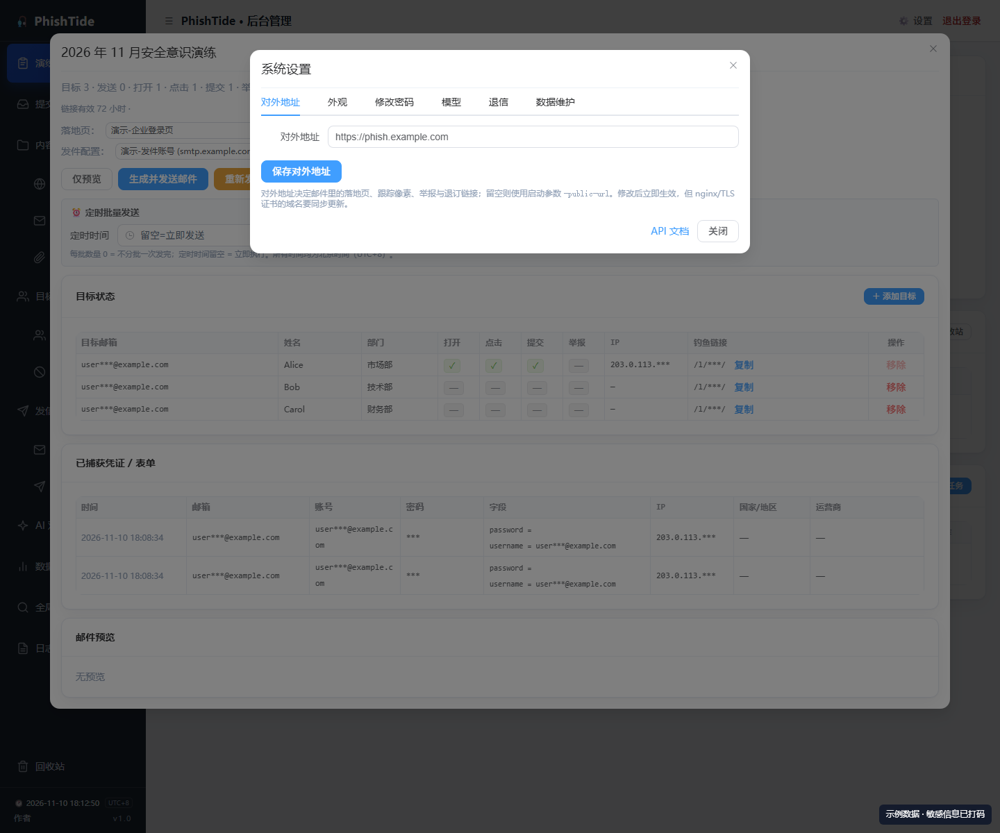

- 决定邮件里的落地页、跟踪像素、举报/退订链接。
- 留空则使用启动参数 `-public-url`。
- 改完立即生效；换服务器/IP 只需要改这里。
- 它只改链接；nginx/TLS 证书的域名要同步更新。

### 16.2 外观

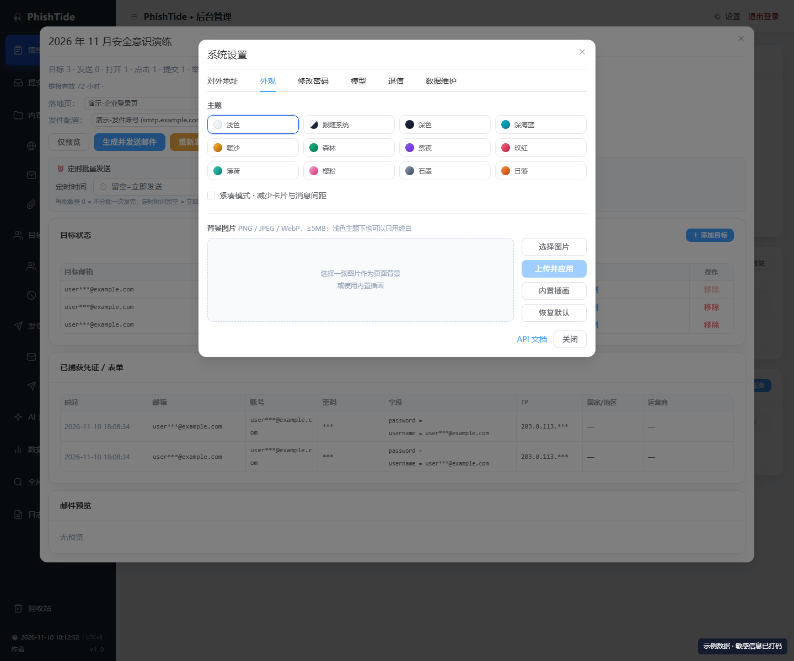

- 主题：浅色 / 跟随系统 / 深色 / 深海蓝 / 暖沙 / 森林 / 紫夜 / 玫红 / 薄荷 / 樱粉 / 石墨 / 日落。
- 背景图：PNG/JPEG/WebP ≤ 5MB，可上传或恢复内置插画。
- 紧凑模式：减少卡片和消息间距。

### 16.3 修改密码

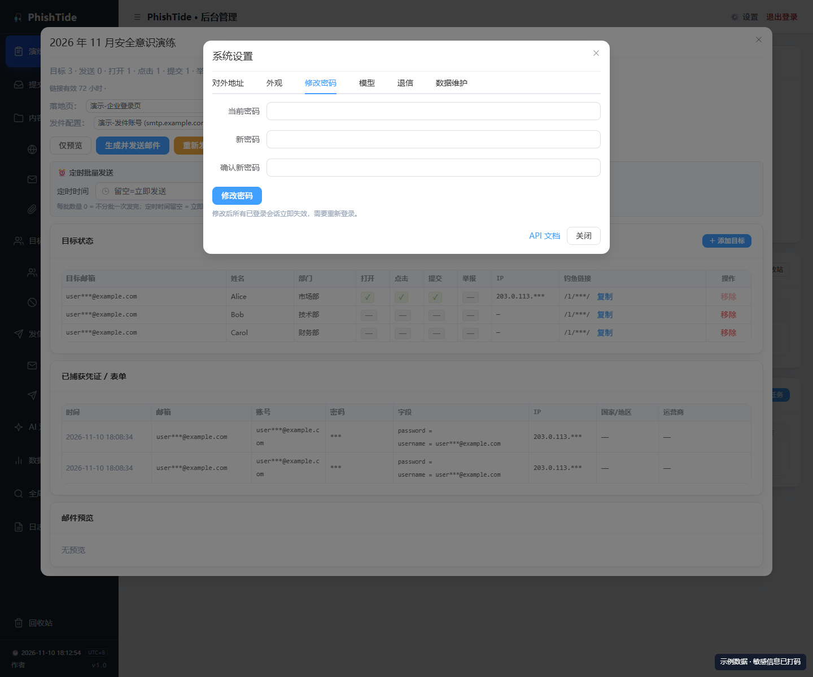

- 需要当前密码；新密码至少 8 位。
- 改密后所有已登录会话立即失效，需要重新登录。

### 16.4 模型

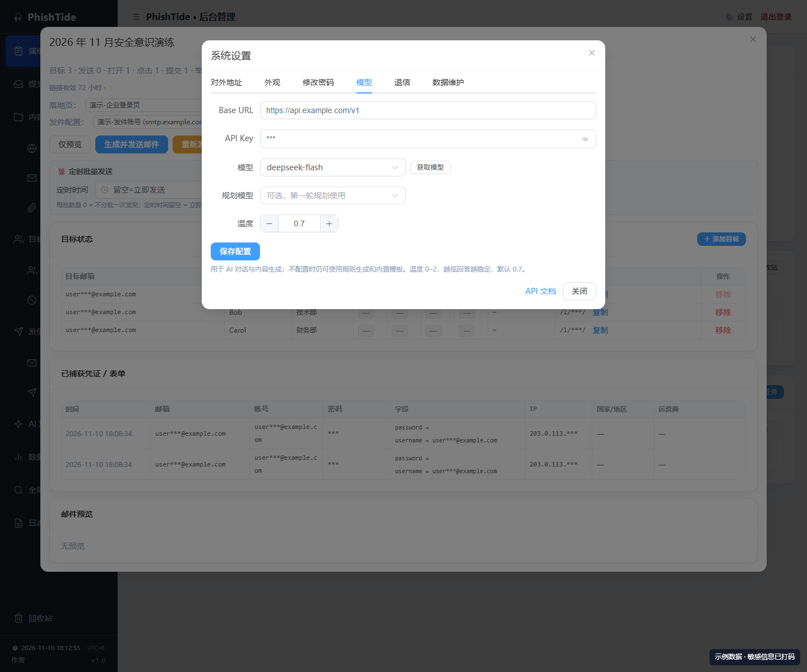

- Base URL：OpenAI 兼容端点，例如 `https://api.deepseek.com/v1`。
- API Key：加密存储；本地 Ollama/vLLM 可留空。
- 模型：可手动输入或点「获取模型」拉取服务商列表。
- 规划模型（可选）：Agent 第一轮规划使用。
- 温度：0–2，默认 0.7。

### 16.5 退信

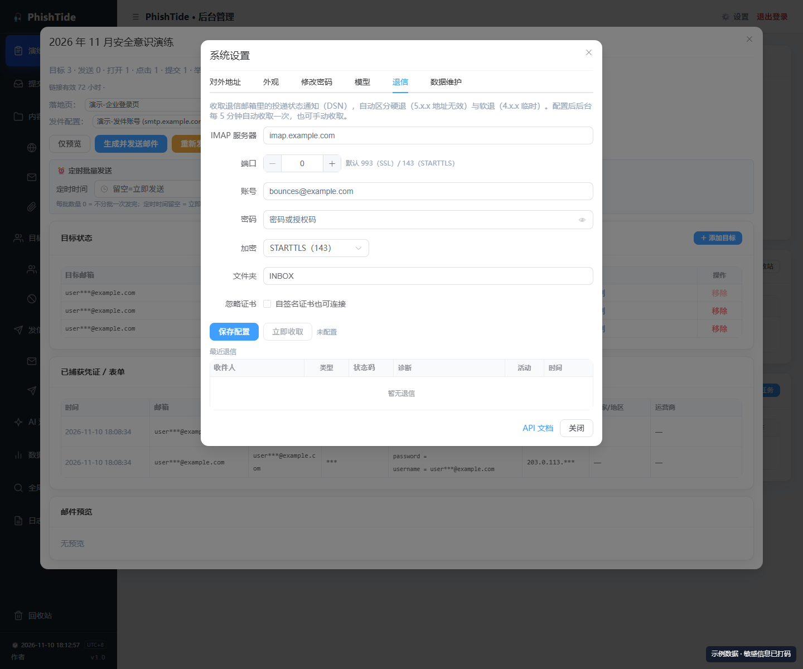

- 配置 IMAP 邮箱，平台每 5 分钟自动收取 DSN 退信。
- 硬退（5.x.x）标记 `bounced` 并加入抑制名单；软退（4.x.x）标记 `delayed`。
- 支持 ssl / starttls / none；明文只允许本机回环。
- 下方显示最近退信。

### 16.6 数据维护

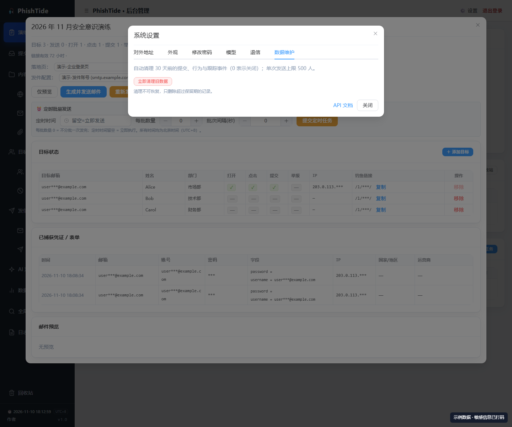

- 显示自动清理天数、单次发送上限。
- 「立即清理旧数据」：只删除超过保留期的提交和事件，不可恢复。
- 日志保留天数在「日志」页单独设置。

---

## 17. 风险报告

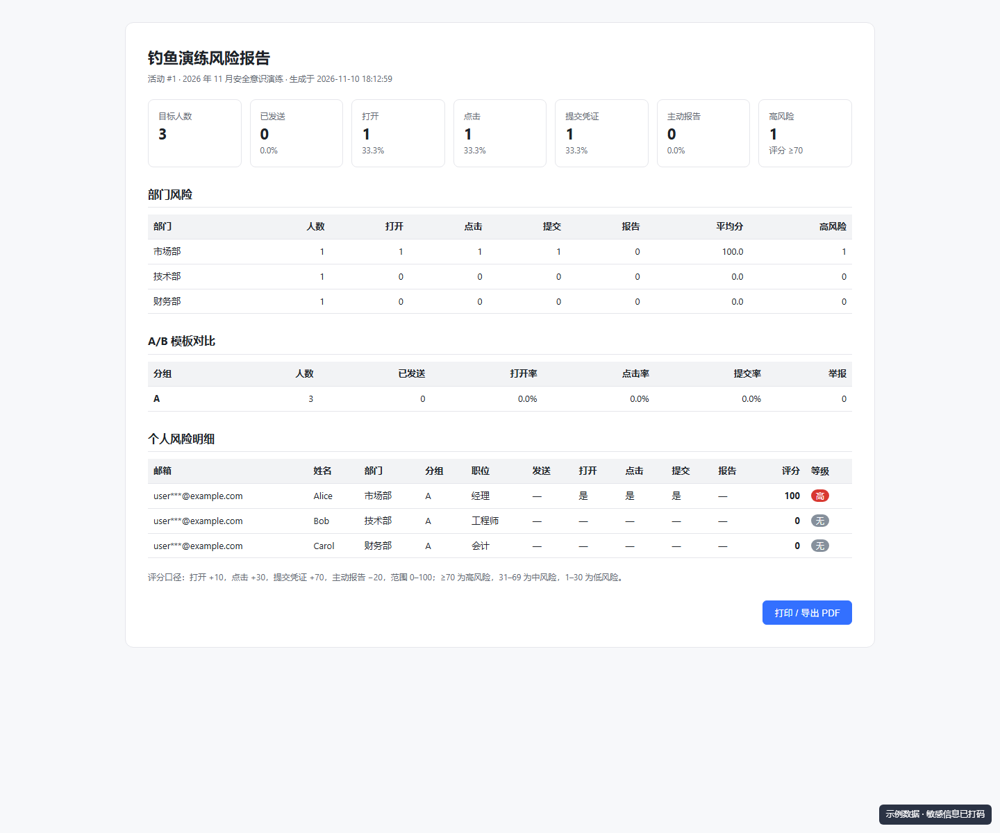

- 从活动详情「风险报告」打开，或在地址栏访问 `/__admin/api/report?campaign_id=1&format=html`。
- 评分口径：打开 +10、点击 +30、提交凭证 +70、主动报告 −20，范围 0–100；≥70 高风险。
- 包含：目标人数、已发送、打开/点击/提交/举报、部门风险、A/B 对比、个人明细。
- 「打印 / 导出 PDF」可直接打印或另存 PDF。

---

## 18. 回收站

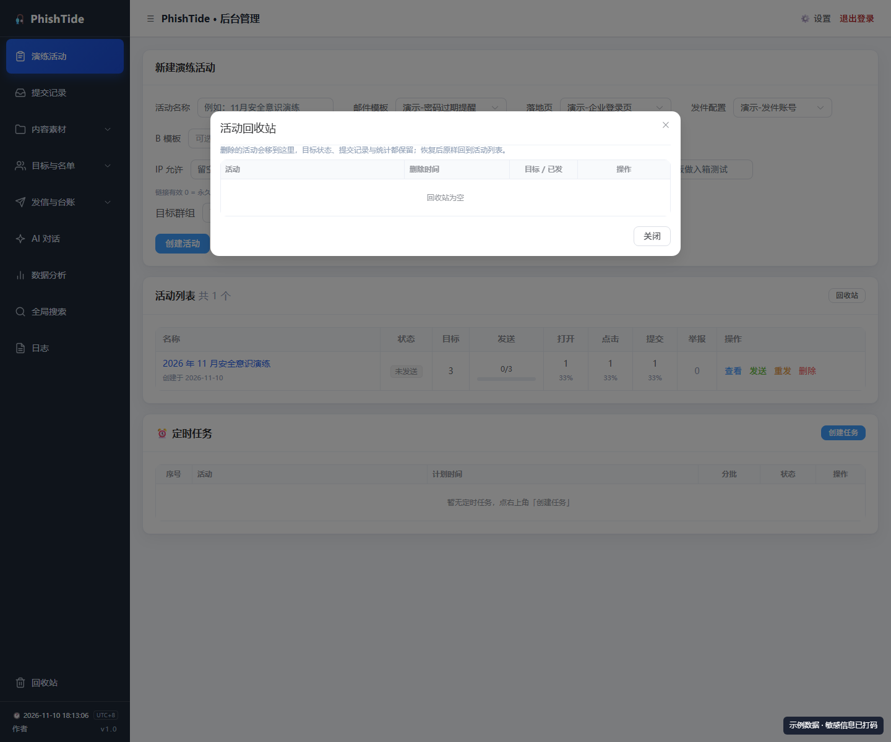

- 删除活动是**软删除**：活动进回收站，目标状态、提交、事件、统计都保留。
- 可以「恢复」；恢复时会校验模板/落地页/发件账号/目标组是否还在。
- 「彻底删除」会删除该活动的所有数据，不可恢复。
- 模板/落地页/发件账号/目标组被活动引用时（包括回收站里的活动）不允许删除。

---

## 19. API 文档

- 「设置」弹窗底部有 **API 文档** 链接。
- 直接访问：`https://你的IP:8443/__admin/api/openapi.yaml`。
- 需要登录会话 Cookie 或 `Authorization: Bearer <admin-key>`。
- 常用端点、SSE 对话流、curl 示例见 `docs/zh-CN/API.md`。

---

## 20. 一键部署

如果还没部署，直接看：

- [Ubuntu/Debian 一键部署（小白版）](ONE-CLICK.md)
- Release 里的 `phishsim-oneclick-linux-amd64.tar.gz`

---

## 21. AI 一键发送实战

以下截图来自本机真实 AI Agent 测试：收件人邮箱、姓名、发件账号等敏感信息已打码；实际发送成功 1 封，失败 0。

### 21.1 给 AI 的指令

在「AI 对话」里直接说：

```
帮我做一次 AI 一键发送测试：
1. 新建目标组「AI 测试」，收件人只有 <你的测试邮箱>。
2. 生成测试邮件模板，主题「【测试】AI 一键发送」，正文含 {{.TrackingURL}} 和 {{.TrackingPixel}}。
3. 创建一个登录落地页，表单 action 用 __SUBMIT_URL__。
4. 使用现有 QQ 发件账号，不要新建，不要读取密码。
5. 创建活动并绑定模板、落地页、目标组、发件账号。
6. 先 dry_run_campaign，再 send_campaign 发起发送确认。
```

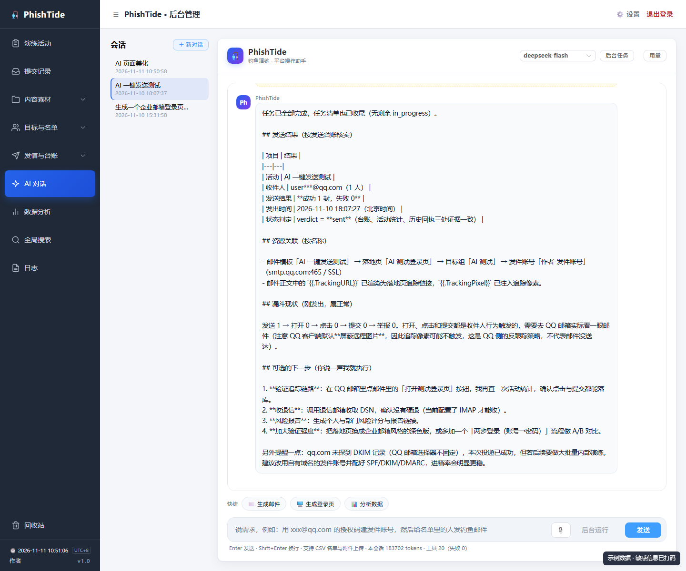

AI 会自动调用这些工具：

```
create_group → create_email_template → create_landing_page
→ validate_page → e2e_check_page → create_campaign
→ dry_run_campaign → send_campaign
```

其中 `create_campaign`、`send_campaign` 会弹确认；操作员确认后才继续/真正发信。

### 21.2 AI 的执行与结果


- AI 自己建了群组、模板、落地页，跑了 `validate_page` 和真实浏览器 `e2e_check_page`。
- 干跑通过后调用 `send_campaign`，弹出「确认发送」。
- 确认后实际投递成功，台账 `verdict=sent`。

### 21.3 活动详情（发送成功）

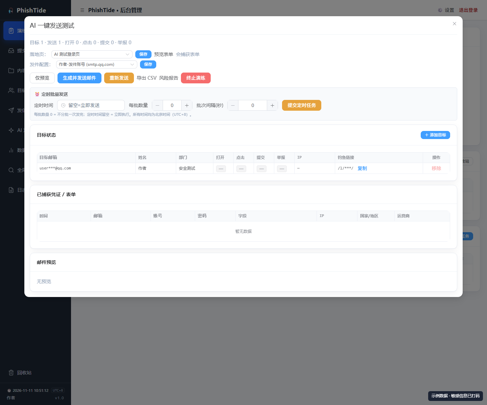

- 目标 1、发送 1、打开 0、点击 0、提交 0。
- 打开/点击/提交需要收件人实际点开邮件里的链接；QQ 客户端默认屏蔽远程图片，所以追踪像素可能不触发。
- 发件账号显示为「作者-发件账号」（已打码）。

### 21.4 AI 生成的登录页

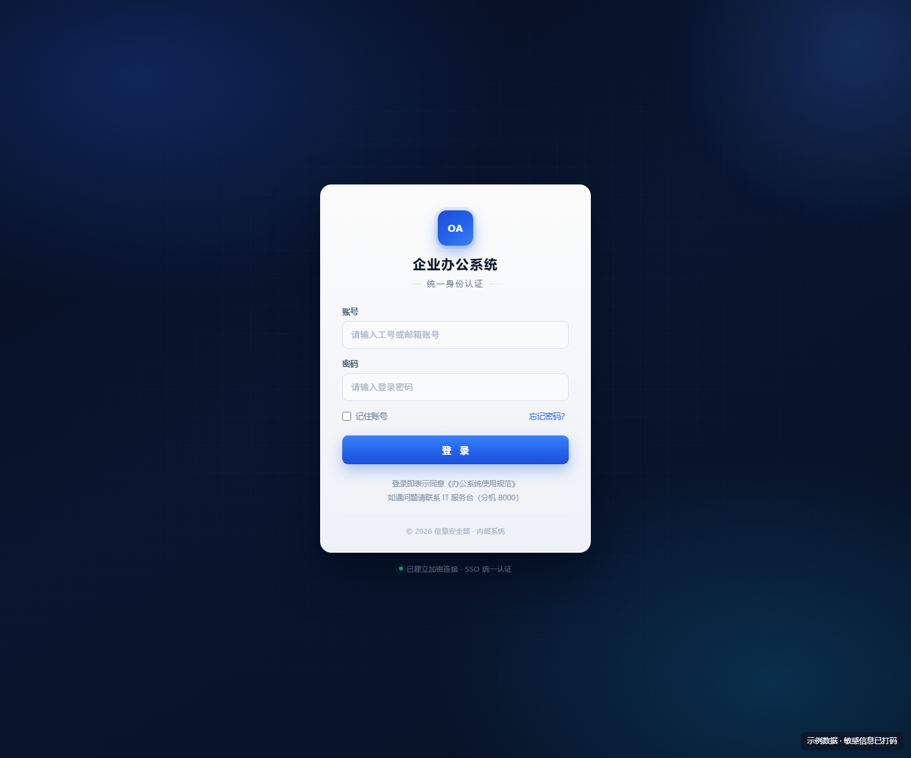

- AI 根据指令生成了「企业办公系统 · 统一身份认证」的**深色企业风格**登录页：深蓝渐变背景、居中白色卡片、蓝色登录按钮。
- 截图取自真实落地页 `/l/<token>/`。后台 `/p/` 预览为了安全会禁用内联样式和脚本，看起来可能没有样式，这是正常的；要看完整效果请打开真实链接。
- 表单字段、失败提示、跳转都可以继续让 AI 调整，例如：
  - “把页面改成浅色企业风格”
  - “增加一个两步登录流程”
  - “把登录失败提示改成英文”

### 21.5 相关截图

| 截图 | 内容 |
| --- | --- |
| `24a-ai-chat-top` | AI 对话开头（Prompt） |
| `24b-ai-chat-result` | AI 最终结果（发送成功） |
| `25-ai-campaign-detail` | 活动详情：发送 1 |
| `26-ai-page` | AI 生成的登录页 |

---

<p align="center">
  <br>
  <strong>还有问题？扫码联系作者</strong>
</p>
